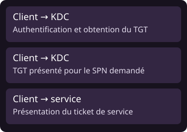

# Kerberos et Active Directory

## Du TGT au ticket de service

Le KDC du domaine assure deux fonctions. Son service d’authentification délivre un Ticket Granting Ticket (TGT). Son service d’émission de tickets accepte ensuite ce TGT pour délivrer un ticket destiné à un service identifié par son SPN. Le client présente ce dernier au service. La ressource évalue encore les droits de l’utilisateur.

Dans le cache Windows, un ticket dont le service est krbtgt correspond à un TGT. Pour un ticket de service, relever le principal serveur, le domaine et la période de validité. Le cache est lié à une session. L’absence d’une entrée dans la console courante ne décrit pas les autres sessions de la machine.

## Délégation et S4U

Une application frontale peut avoir besoin de contacter un service aval pour le compte d’un utilisateur. La question à poser est « qui autorise quel service à représenter cet utilisateur auprès de quelle ressource ? ».

| Modèle | Où lire la décision | Portée |
|---|---|---|
| Unconstrained Delegation | Compte du service frontal approuvé pour la délégation | L’usage d’informations Kerberos déléguées peut s’étendre à plusieurs services aval. |
| Constrained Delegation classique | Configuration du compte frontal | Les services aval autorisés sont nommés par SPN. |
| Resource-Based Constrained Delegation | Configuration de la ressource aval | La ressource désigne les identités frontales habilitées. |

S4U2Self permet à un service d’obtenir un ticket vers lui-même pour une identité utilisateur. S4U2Proxy concerne la demande suivante, destinée à un service aval. La réussite de la première étape ne prouve pas que la seconde est autorisée. Les paramètres des comptes, les restrictions de délégation et la politique du KDC interviennent dans la décision.

## Domain Trusts et Forest Trusts

Si le domaine A fait confiance au domaine B, une ressource de A peut reconnaître une identité de B. Dessiner séparément le sens de la confiance et le trajet de l’utilisateur évite d’inverser une relation entrante ou sortante. L’accès final exige aussi les permissions sur la ressource. Pour une relation de forêt, examiner en plus sa portée et les éventuelles restrictions d’authentification.

## Active Directory Certificate Services

Une autorité de certification délivre un certificat selon les règles d’un modèle et les conditions d’inscription. Pour évaluer un modèle, distinguer qui peut demander le certificat, qui détermine l’identité inscrite, quels usages sont déclarés et quelle validation précède l’émission. Un certificat émis ne garantit pas que le service visé l’acceptera pour authentifier cette identité.

[Consulter les tickets de la session](../cheatsheets/identites#lister-les-tickets-kerberos)
