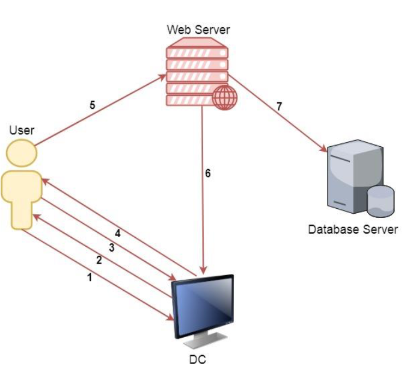
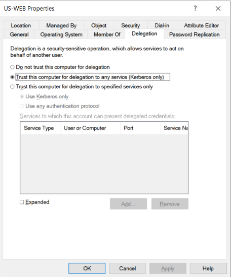
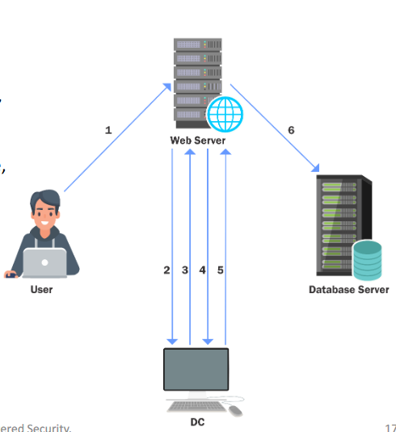
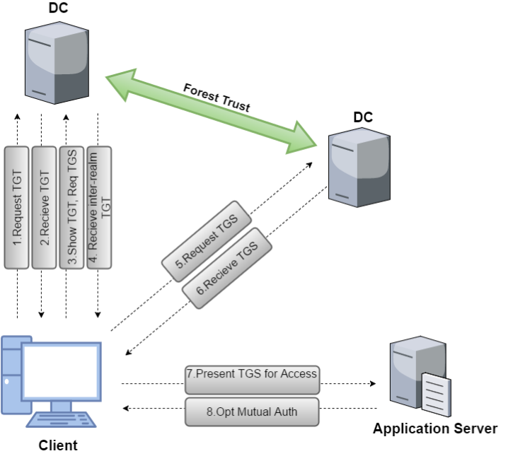
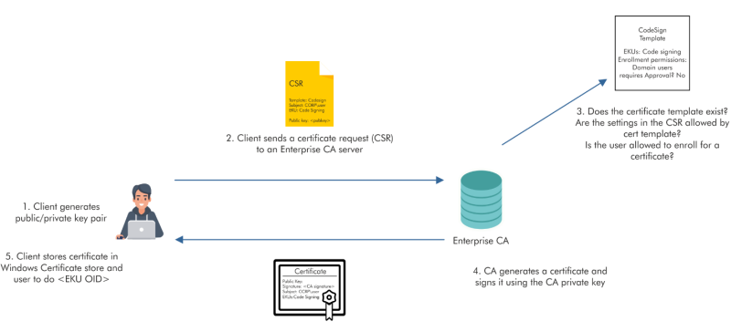

# AD PrivEsc

Étude des risques Kerberos, des délégations, des relations d'approbation, d'AD CS et de SQL Server.

## Kerberoasting


Le risque concerne les comptes de service associés à des SPN dont les mots de passe ne présentent pas une robustesse suffisante.

### Inventaire des comptes de service

```powershell
Get-ADUser -Filter {ServicePrincipalName -ne "$null"} -Properties ServicePrincipalName
```

Recense les comptes utilisateurs disposant d'un SPN.

## AS-REP Roasting

L'absence de préauthentification Kerberos constitue un risque de sécurité.

### Vérification de la préauthentification

```powershell
Get-ADUser -Filter {DoesNotRequirePreAuth -eq $True} -Properties DoesNotRequirePreAuth
```

Identifie les comptes configurés sans préauthentification Kerberos.

## Targeted Kerberoasting

Les notes mettent en relation les droits de modification d'objets AD avec les attributs SPN et UserAccountControl. Examiner les délégations de droits qui permettent ces changements.

## Kerberos Delegation







La délégation permet à un service d'accéder à une autre ressource au nom d'un utilisateur, notamment dans un scénario multi-tiers.

- Unconstrained Delegation : délégation non limitée à des services désignés.
- Constrained Delegation : délégation limitée aux services configurés.
- Resource-based Constrained Delegation : autorisations définies sur la ressource de destination.

### Ordinateurs configurés pour la délégation non contrainte

```powershell
Get-ADComputer -Filter {TrustedForDelegation -eq $True}
```

Liste les ordinateurs configurés avec cet attribut.

### Comptes utilisateurs configurés pour la délégation non contrainte

```powershell
Get-ADUser -Filter {TrustedForDelegation -eq $True}
```

Liste les utilisateurs possédant cet attribut.

Le chapitre traite aussi du service Spooler et du risque d'authentification forcée dans ce contexte.

## Forest & Domain Trusts




Les notes distinguent les relations parent-enfant et les approbations entre forêts. Les relations d'approbation et le filtrage des SID font partie de la revue des frontières de sécurité.

## Active Directory Certificate Services



Le document couvre les configurations à risque ESC1, ESC3 et ESC6. Examiner les droits d'inscription, les modèles de certificats, la configuration des autorités et la validation des identités.

## Microsoft SQL Server

Les liens entre serveurs SQL peuvent étendre le périmètre des accès. Contrôler les identités utilisées, les droits associés et les relations entre instances.
