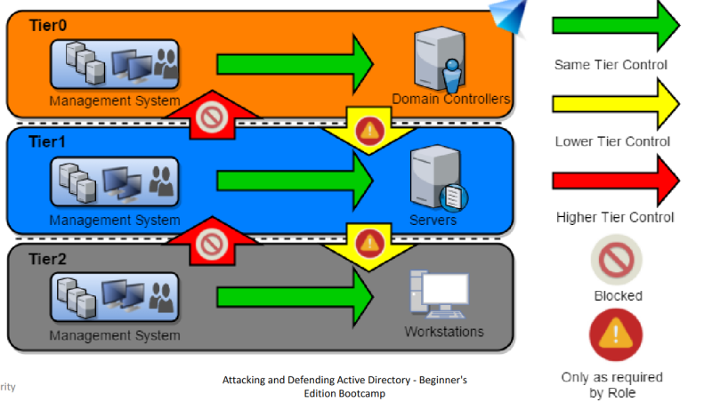
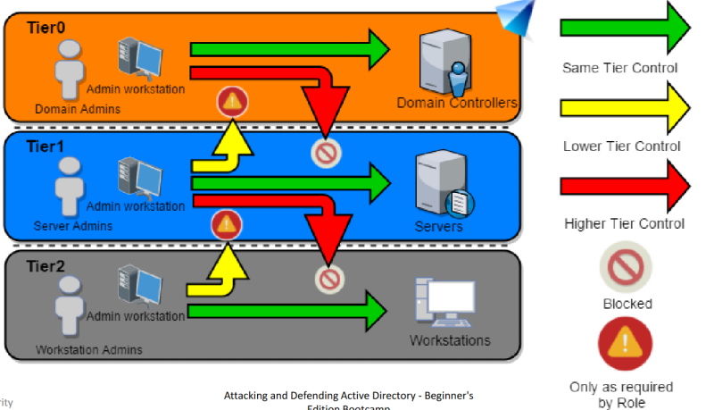

# AD Defense

Mesures de protection et de détection présentées dans les notes CRTP.

## Comptes privilégiés

Réduire le nombre de Domain Admins, limiter leurs ouvertures de session aux systèmes nécessaires et éviter les comptes de service excessivement privilégiés.

## Protected Users

Le groupe Protected Users réduit certaines formes de mise en cache des identifiants et limite les mécanismes d'authentification. Tester les impacts avant déploiement.

## PAW

Les Privileged Administrative Workstations isolent les tâches d'administration sensibles des usages quotidiens.

## LAPS

La solution LAPS permet de gérer et renouveler les mots de passe administrateurs locaux. Les notes de 2023 décrivent principalement LAPS historique ; distinguer cette version de Windows LAPS actuel lors d'une mise en œuvre.

## JIT et JEA

- Just In Time : limiter dans le temps les privilèges administratifs.
- Just Enough Administration : limiter les opérations d'administration aux actions nécessaires.

## Tier Model et ESAE






Les notes distinguent Tier 0 (identité et infrastructure critique), Tier 1 (serveurs) et Tier 2 (postes de travail). ESAE est présenté comme un modèle historique de forêt administrative.

## Credential Guard et WDAC

Credential Guard isole certains secrets à l'aide de la sécurité basée sur la virtualisation. WDAC contrôle l'exécution des applications selon la politique appliquée.

## Microsoft Defender for Identity

MDI surveille les signaux liés aux identités, aux authentifications et aux opérations AD. Examiner les alertes avec les journaux des systèmes concernés.

## Événements Windows à examiner

| ID | Journal | Indication |
| --- | --- | --- |
| 4624 | Security | Ouverture de session réussie |
| 4634 | Security | Fermeture de session |
| 4672 | Security | Privilèges spéciaux attribués |
| 4673 | Security | Utilisation d'un service privilégié |
| 4769 | Security | Demande de ticket de service Kerberos |
| 4657 | Security | Modification d'une valeur du registre |
| 4662 | Security | Opération sur un objet |
| 5136 | Security | Modification d'un objet d'annuaire |
| 4670 | Security | Modification de permissions |
| 7045 | System | Installation d'un service |

### Ouvertures de session privilégiées

```powershell
Get-WinEvent -FilterHashtable @{LogName='Security';ID=4672} -MaxEvents 1 | Format-List -Property *
```

Consulte le dernier événement correspondant. Un événement isolé ne prouve pas une compromission.

### Services installés

```powershell
Get-WinEvent -FilterHashtable @{LogName='System';ID=7045}
```

Consulte les événements d'installation de services.

## Détection des techniques AD


Les notes associent les tickets falsifiés, Skeleton Key, DSRM, SSP, Kerberoasting, délégation, ACL et Trust Tickets à différents signaux d'audit. La disponibilité des événements dépend de la configuration de journalisation.

## Deception

Les comptes et objets leurres peuvent contribuer à détecter des interactions anormales. Définir un processus de surveillance, de validation et de réponse.

## Ressources

- [Credential Guard](https://learn.microsoft.com/en-us/windows/security/identity-protection/credential-guard/)
- [LOLBAS](https://lolbas-project.github.io/)
