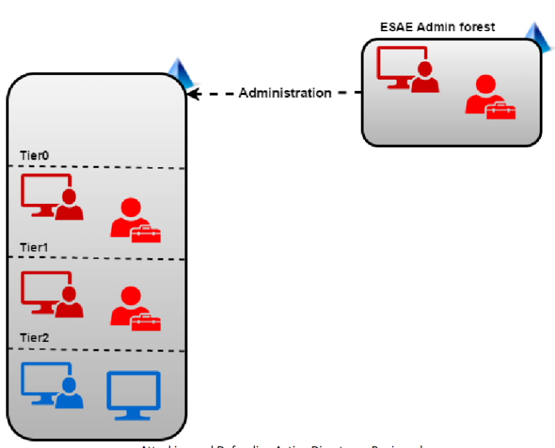
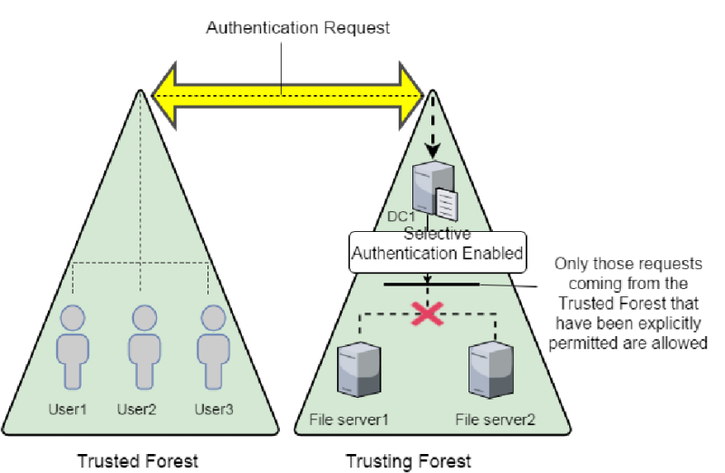

# Détection et défense

- Protéger et limiter les comptes Domain Admins
- Isoler les postes d'administration
- Sécuriser les comptes administrateur locaux
- Mettre en place une administration temporaire et limitée au nécessaire
- Isoler les administrateurs dans une forêt dédiée et limiter la propagation d'une compromission grâce au modèle par niveaux et à ESAE

## Protéger et limiter les comptes Domain Admins

- Réduire le nombre de comptes Domain Admins dans l’environnement.
- Interdire ou limiter les connexions des Domain Admins aux contrôleurs de domaine. Si une connexion à certains serveurs est nécessaire, empêcher les autres administrateurs de se connecter à ces mêmes machines.
- Éviter autant que possible d'exécuter un service avec un compte Domain Admin. Les protections contre le vol d'identifiants présentées dans ce chapitre deviennent inefficaces lorsqu'un compte de service privilégié est utilisé.

> Activer le paramètre **Account is sensitive and cannot be delegated** pour les comptes Domain Admins.

## Groupe Protected Users

Le groupe **Protected Users**, introduit avec Windows Server 2012 R2, renforce la protection contre le vol d’identifiants en empêchant leur mise en cache selon des mécanismes considérés comme moins sûrs. Un utilisateur ajouté à ce groupe bénéficie notamment des protections suivantes sur les postes :

- CredSSP et WDigest ne peuvent pas être utilisés : les identifiants en clair ne sont plus mis en cache.
- Le hash NTLM n’est pas mis en cache.
- Kerberos n’utilise ni les clés DES ni les clés RC4. Les identifiants en clair et les clés à long terme ne sont pas mis en cache.

Si le niveau fonctionnel du domaine est Windows Server 2012 R2, les contrôleurs de domaine appliquent également les protections suivantes :

- Aucune authentification NTLM.
- Aucune clé DES ou RC4 lors de la pré-authentification Kerberos.
- Aucune délégation, qu’elle soit contrainte ou non contrainte.
- Le TGT ne peut pas être renouvelé au-delà de sa durée initiale de quatre heures. Les paramètres **Maximum lifetime for user ticket** et **Maximum lifetime for user ticket renewal** sont imposés et ne peuvent pas être configurés.

- Tous les contrôleurs de domaine doivent exécuter Windows Server 2008 ou une version ultérieure afin de prendre en charge les clés AES.
- Microsoft déconseille d’ajouter directement les Domain Admins et Enterprise Admins à ce groupe sans avoir testé au préalable le risque de blocage de leurs comptes.
- L’ouverture de session hors ligne n’est pas possible : les identifiants ne sont pas mis en cache.
- Ajouter des comptes ordinateurs ou des comptes de service à ce groupe n’apporte pas de protection utile, car leurs identifiants sont présents sur la machine qui les utilise.

## Isoler les postes d'administration

**Privileged Administrative Workstations (PAWs)**

- Un poste renforcé destiné aux opérations sensibles : administration des contrôleurs de domaine, de l’infrastructure cloud ou des fonctions métier critiques.
- Il permet notamment de réduire l’exposition au phishing, aux vulnérabilités du système d’exploitation et aux attaques par rejeu d’identifiants.
- Les serveurs de rebond d’administration (Jump Servers) doivent être accessibles uniquement depuis une PAW. Plusieurs stratégies sont possibles :

```text
- Séparer les privilèges et le matériel utilisés pour les tâches d'administration de ceux utilisés pour les tâches courantes.
- Utiliser une machine virtuelle sur la PAW pour les activités utilisateur.
```

## Sécuriser les comptes administrateur locaux

**LAPS (Local Administrator Password Solution)**

- Centraliser les mots de passe dans Active Directory et les renouveler aléatoirement à intervalles réguliers, avec un contrôle des autorisations de lecture.
- Les objets ordinateurs disposent de deux attributs : ms-mcs-AdmPwd stocke le mot de passe en clair et ms-mcs-AdmPwdExpirationTime contrôle son renouvellement.
- Le mot de passe est stocké en clair, mais sa transmission est chiffrée.

> [Remarque] Une énumération précise permet d’identifier les utilisateurs autorisés à lire ces mots de passe et donc de repérer les comptes présentant un intérêt particulier.

## Administration temporaire - JIT
**Just In Time (JIT)** permet d’accorder des privilèges administrateur pour une durée limitée et à la suite d’une demande.

L’appartenance temporaire à un groupe peut être utilisée pour accorder ces droits. Cette fonctionnalité nécessite l’activation de **Privileged Access Management (PAM)**. Une fois cette fonctionnalité activée, elle ne peut plus être désactivée. 
```powershell
Add-ADGroupMember -Identity 'Domain Admins' -Members newDA -MemberTimeToLive (New-TimeSpan -Minutes 60)
```

## Administration au juste nécessaire - JEA
**JEA (Just Enough Administration)** fournit un contrôle d’accès basé sur les rôles pour déléguer à distance des tâches d’administration avec PowerShell.

- Les utilisateurs non administrateurs peuvent se connecter à distance aux machines pour effectuer uniquement certaines tâches administratives.
- Il est possible de contrôler les commandes qu’un utilisateur peut exécuter et de limiter les paramètres qu’il peut utiliser.
- Les points de terminaison JEA activent la transcription et la journalisation PowerShell.

## Modèle de niveaux - Détection et défense

**Active Directory Administrative Tier Model**

Le modèle administratif Active Directory comporte trois niveaux, réservés aux comptes et ressources d’administration :

- **Tier 0** : comptes, groupes et ordinateurs disposant de privilèges à l’échelle de l’entreprise, comme les contrôleurs de domaine, les Domain Admins et les Enterprise Admins.
- **Tier 1** : comptes, groupes et ordinateurs ayant accès à des ressources présentant une valeur métier importante. Les administrateurs de serveurs en sont un exemple : ils gèrent les systèmes d’exploitation et peuvent affecter les services de l’entreprise.
- **Tier 2** : comptes administrateur qui disposent d’un contrôle sur des ressources métier importantes hébergées sur les postes de travail et les équipements des utilisateurs. Les équipes Help Desk et support informatique en sont des exemples, car elles peuvent affecter l’intégrité des données de presque tous les utilisateurs.

> **Control Restrictions** : ce que les administrateurs peuvent contrôler.
> **Logon Restrictions** : les machines sur lesquelles les administrateurs peuvent se connecter.

### Modèle de niveaux : restrictions de contrôle


### Modèle de niveaux : restrictions de connexion


## ESAE

**ESAE (Enhanced Security Admin Environment)**

- Une forêt d’administration dédiée à la gestion des ressources critiques : comptes, groupes et ordinateurs d’administration.
- Une forêt étant considérée comme une frontière de sécurité, ce modèle permet d’appliquer des contrôles de sécurité renforcés.
- La forêt d’administration est également appelée **Red Forest**.
- Dans la forêt de production, les comptes administrateur sont utilisés comme des comptes standards non privilégiés dans la forêt d’administration.
- L’authentification sélective vers la Red Forest permet de renforcer les contrôles appliqués aux connexions des utilisateurs provenant des forêts de production.

> Microsoft a retiré ESAE en 2021 et l’a remplacé par la stratégie **Privileged Access**. Le modèle reste néanmoins présenté dans ces notes.



## Credential Guard

> Credential Guard utilise la sécurité basée sur la virtualisation pour isoler les secrets. Seuls les composants logiciels système disposant des privilèges nécessaires peuvent y accéder.

Cette protection limite les attaques **Pass-the-Hash (PTH)** et **Over-Pass-the-Hash (OPTH)** en restreignant l’accès aux hashes NTLM et aux TGT. Même avec des identifiants valides, il n’est pas possible d’écrire des tickets Kerberos en mémoire.

[Documentation Windows Credential Guard](https://docs.microsoft.com/en-us/windows/access-protection/credential-guard/credential-guard)

- Les identifiants des comptes locaux stockés dans SAM et ceux des comptes de service présents dans LSA Secrets ne sont pas protégés.
- Credential Guard ne peut pas être activé sur un contrôleur de domaine, car cela perturbe l’authentification.
- La fonctionnalité est disponible sur Windows 10 Enterprise et Windows Server 2016.
- Mimikatz peut la contourner. Cela ne constitue toutefois pas une raison pour renoncer à son utilisation.

## Device Guard (WDAC)

> Device Guard regroupe des fonctionnalités destinées à renforcer un système contre les logiciels malveillants. Son objectif est d’empêcher l’exécution de code malveillant en autorisant uniquement le code considéré comme fiable.

Trois composants principaux :
```text
- **Configurable Code Integrity (CCI)** : configurer l'exécution pour n'autoriser que le code approuvé.
- **Virtual Secure Mode Protected Code Integrity** : appliquer CCI en mode noyau (KMCI) et en mode utilisateur (UMCI).
- **Platform and UEFI Secure Boot** : garantir l'intégrité des fichiers de démarrage et du firmware.
```

[Présentation de Device Guard, de la sécurité basée sur la virtualisation et des stratégies d’intégrité du code](https://docs.microsoft.com/en-us/windows/device-security/device-guard/introduction-to-device-guard-virtualization-based-security-and-code-integrity-policies)

- UMCI peut bloquer une grande partie des techniques de mouvement latéral présentées dans le cours.
- Selon la configuration déployée, certaines méthodes connues de contournement de l’Application Whitelisting peuvent également contourner UMCI. Elles reposent notamment sur l’utilisation de binaires signés comme csc.exe ou MSBuild.exe.

Consulter le projet LOLBAS :

[Projet LOLBAS](https://lolbas-project.github.io)

## MDI

**Identifier, détecter et analyser les menaces avancées, les identités compromises et les actions malveillantes internes visant une organisation.**

- Les capteurs MDI sont installés sur les contrôleurs de domaine et les serveurs de fédération. L’analyse et les alertes sont ensuite traitées dans le cloud Azure.

MDI peut notamment détecter :
```text
- Reconnaissance.
- Identifiants compromis (Brute Force, Kerberoasting, etc.).
- Mouvement latéral (PTH, OPTH, etc.).
- Prise de contrôle du domaine (DCSync, Golden Ticket, Skeleton Key, etc.).
- Exfiltration.
```

### Contournement de MDI

> L’idée consiste à limiter autant que possible les échanges avec le contrôleur de domaine et à faire en sorte que le trafic généré ressemble à une activité normale.

- Pour contourner la détection DCSync, les notes évoquent l’utilisation de comptes placés sur liste d’autorisation. Le compte utilisé pour Password Hash Synchronization (PHS) peut, par exemple, être autorisé.
- Si le hash NTLM d’un contrôleur de domaine est disponible, les notes mentionnent l’utilisation de NetSync pour extraire les hashes NTLM de comptes ordinateurs.
- Un Golden Ticket contenant dans SIDHistory les SID des groupes Domain Controllers et Enterprise Domain Controllers peut être moins facilement détecté par MDI.

```powershell
C:\AD\Tools\BetterSafetyKatz.exe "kerberos::golden /user:dcorp-dc$ /domain:dollarcorp.moneycorp.local /sid:S-1-5-21-1874506631-3219952063-538504511 /groups:516 /sids:S-1-5-21-280534878-1496970234-700767426-516,S-1-5-9 /krbtgt:4e9815869d2090ccfca61c1fe0d23986 /ptt" "exit"
```

## Détection d'un Golden Ticket

**Événements Windows à surveiller**

ID d’événement :
```text
- **4624** : ouverture de session d'un compte.
- **4672** : attribution de privilèges spéciaux lors d'une ouverture de session.
```

```powershell
Get-WinEvent -FilterHashtable @{Logname='Security';ID=4672} -MaxEvents 1 | Format-List -Property *
```

## Détection d'un Silver Ticket

**Événements Windows à surveiller**

ID d’événement :
```powershell
- **4624** : ouverture de session d'un compte.
- **4634** : fermeture de session d'un compte.
- **4672** : attribution de privilèges spéciaux lors d'une ouverture de session.
```

```powershell
Get-WinEvent -FilterHashtable @{Logname='Security';ID=4672} -MaxEvents 1 | Format-List -Property *
```

## Détection d'un Skeleton Key

**Événements à surveiller** :
```text
- **System - ID 7045** : un service a été installé sur le système (type : pilote en mode noyau).
```

Événements à surveiller (**Audit privilege use** doit être activé) :
```text
- **Security - ID 4673** : utilisation d'un privilège sensible (Sensitive Privilege Use).
- **ID 4611** : un processus d'ouverture de session approuvé a été enregistré auprès de Local Security Authority.
```

```powershell
Get-WinEvent -FilterHashtable @{Logname='System';ID=7045} | ?{$_.message -like "*Kernel Mode Driver*"}
```

**À éviter** :
```powershell
Get-WinEvent -FilterHashtable @{Logname='System';ID=7045} | ?{$_.message -like "*Kernel Mode Driver*" -and $_.message -like "*mimidrv*"}
```

**Mesure de protection** :
```text
- Exécuter lsass.exe en tant que processus protégé est utile, car cela oblige un attaquant à charger un pilote en mode noyau.
- Tester soigneusement cette protection : certains pilotes et modules complémentaires peuvent ne plus se charger lorsqu'elle est activée.
```

```powershell
New-ItemProperty HKLM:\SYSTEM\CurrentControlSet\Control\Lsa\ -Name RunAsPPL -Value 1 -Verbose
# Vérifier après un redémarrage
Get-WinEvent -FilterHashtable @{Logname='System';ID=12} | ?{$_.message -like "*protected process*"}
```

## Détection d’un accès DSRM

**Événements à surveiller** :
```text
- **ID 4657** : création ou modification de la clé HKLM:\System\CurrentControlSet\Control\Lsa\DsrmAdminLogonBehavior (l'audit des modifications de registre doit être activé).
```

## Détection d’un SSP malveillant

Events:
```text
- **ID 4657** : création ou modification de la clé HKLM:\System\CurrentControlSet\Control\Lsa\SecurityPackages (l'audit des modifications de registre doit être activé).
```

## Détection du Kerberoasting

**Événements à surveiller** :
```text
- **Security - ID 4769** : un ticket Kerberos a été demandé.
```

**Mesure de protection** :
```text
- Utiliser des mots de passe de comptes de service difficiles à deviner, de préférence de plus de 35 caractères.
- Utiliser des **Group Managed Service Accounts (gMSA)** : leur mot de passe est renouvelé automatiquement et la gestion des SPN peut être déléguée.
```
	
L’événement 4769 est très fréquent sur un contrôleur de domaine. Pour affiner l’analyse, les notes proposent de filtrer les événements selon les critères suivants :
```text
- Le nom du service ne doit pas être krbtgt.
- Le nom du service ne doit pas se terminer par $ afin d'exclure les comptes ordinateurs utilisés pour les services.
- Le nom du compte ne doit pas être au format machine@domain afin d'exclure les demandes provenant de machines.
- Le code d'échec doit être 0x0 : cela indique une demande réussie.
- Le type de chiffrement du ticket doit notamment être vérifié : 0x17.
```

## Protection contre la délégation non contrainte

**Mesure de protection** :
```text
- Limiter les connexions des comptes DA et administrateurs à des serveurs déterminés.
- Activer le paramètre « Account is sensitive and cannot be delegated » pour les comptes privilégiés.
```

[Analyse du paramètre « Account is sensitive and cannot be delegated » pour les comptes privilégiés](https://blogs.technet.microsoft.com/poshchap/2015/05/01/security-focus-analysing-account-is-sensitive-and-cannot-be-delegated-for-privileged-accounts/)

## Détection des attaques sur les ACL

**Événements à surveiller** :
```text
- **Security - ID 4662** : une opération a été effectuée sur un objet. L'audit de l'accès aux objets doit être activé.
- **Security - ID 5136** : un objet du service d'annuaire a été modifié. L'audit de l'accès aux objets doit être activé.
- **Security - ID 4670** : les autorisations d'un objet ont été modifiées. L'audit de l'accès aux objets doit être activé.
```

**Outil utile** :
```text
- **AD ACL Scanner** : créer des rapports sur les ACL et comparer leurs différences.
```

[ADACLScanner sur GitHub](https://github.com/canix1/ADACLScanner)

## Protection contre les attaques sur les Trusts

**SID Filtering**

- Éviter les attaques qui abusent de l’attribut SIDHistory, notamment l’élévation de privilèges du domaine enfant vers le domaine racine de la forêt (de Domain Admin dans le domaine enfant vers Enterprise Admin dans la racine).
- Le filtrage SID est activé par défaut sur toutes les relations d’approbation inter-forêts. Les relations intra-forêt sont considérées comme sécurisées par défaut, Microsoft considérant la forêt - et non le domaine - comme frontière de sécurité.
- Le filtrage SID peut toutefois perturber certaines applications et l’accès des utilisateurs. Il est donc parfois désactivé.

**Selective Authentication**

> Dans une relation d’approbation inter-forêts, l’authentification sélective empêche l’authentification automatique des utilisateurs entre les forêts. Les accès aux domaines et aux serveurs de la forêt qui accorde l’approbation doivent être autorisés individuellement.



## Déception et leurres (Deception)

> La mise en place de leurres est une technique de défense Active Directory.

- Des objets leurres dans le domaine peuvent inciter un attaquant à suivre un chemin d’attaque particulier. Cela augmente les chances de détection et le temps nécessaire à l’attaquant.
- Historiquement, la déception consistait surtout à déposer de faux identifiants sur certaines machines et à surveiller leur utilisation. Elle peut être employée plus largement, à différentes étapes d’une attaque.

> Que cibler ? Les attaquants recherchent généralement les cibles les plus faciles à exploiter (**lowest hanging fruit**) et peuvent sous-estimer les capacités de défense.

Il faut donc créer des objets qui correspondent à ce que les attaquants recherchent. Pour un compte utilisateur, les caractéristiques susceptibles d’attirer leur attention sont notamment :
```text
- Un utilisateur disposant de privilèges élevés.
- Des autorisations sur d'autres objets.
- Des ACL mal configurées.
- Des attributs utilisateur mal configurés ou dangereux.
```

Les notes proposent d’utiliser [Deploy-Deception sur GitHub](https://github.com/samratashok/Deploy-Deception) pour créer ces objets.

> [Remarque] La stratégie de groupe **Windows Settings / Security Settings / Advanced Audit Policy Configuration / DS Access / Audit Directory Service Access** doit être configurée pour activer la journalisation de l’événement **4662**.

## Leurre utilisateur (User Deception)

Cette technique crée un utilisateur leurre dont le mot de passe n’expire jamais. Un événement **4662** est journalisé lorsque la propriété **x500uniqueIdentifier** (GUID : d07da11f-8a3d-42b6-b0aa-76c962be719a) de cet utilisateur est consultée :
```powershell
Create-DecoyUser -UserFirstName user -UserLastName manager -Password Pass@123 | Deploy-UserDeception -UserFlag PasswordNeverExpires -GUID d07da11f-8a3d-42b6-b0aa-76c962be719a -Verbose
```

Cette propriété n’est pas consultée par **net.exe**, les classes WMI comme **Win32_UserAccount** ou le module ActiveDirectory. En revanche, les outils reposant sur *LDAP*, comme *PowerView* et *ADExplorer*, déclenchent la journalisation.

Un autre scénario consiste à créer un utilisateur leurre nommé decda et à l’ajouter au groupe Domain Admins. Pour limiter les risques d’utilisation abusive, les notes prévoient de lui interdire toute ouverture de session sur les machines.
```powershell
Create-DecoyUser -UserFirstName dec -UserLastName da -Password Pass@123 | Deploy-PrivilegedUserDeception -Technique DomainAdminsMemebership -Protection DenyLogon -Verbose
```

> Toute tentative d’utilisation des identifiants de cet utilisateur, avec son mot de passe ou ses hashes, génère un événement **4768**.
> Toute énumération qui lit sa DACL ou l’ensemble de ses propriétés génère un événement **4662**.

## Documentation

Sécurisation des accès privilégiés :

[Documentation sur la sécurisation des accès privilégiés](https://docs.microsoft.com/en-us/windows-server/identity/securing-privileged-access/securing-privileged-access)

Bonnes pratiques pour sécuriser Active Directory :

[Bonnes pratiques pour sécuriser Active Directory](https://docs.microsoft.com/en-us/windows-server/identity/ad-ds/plan/security-best-practices/best-practices-for-securing-active-directory)

