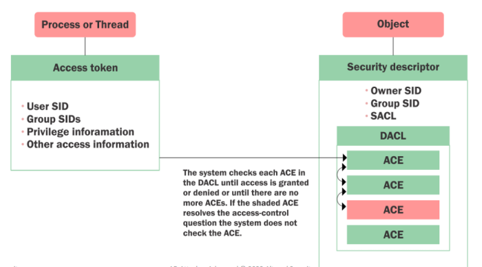

# Énumération Active Directory

<LabVariables ad />

- Domaine
- GPO 
- ACL 
- Trusts 
- User Hunting
- BloodHound

## Énumération du domaine


### Module ActiveDirectory
Module PowerShell signé par Microsoft.

[Documentation Microsoft](https://docs.microsoft.com/en-us/powershell/module/addsadministration/)

[ADModule on GitHub](https://github.com/samratashok/ADModule)

```powershell
Import-Module C:\AD\Tools\ADModule-master\Microsoft.ActiveDirectory.Management.dll
Import-Module C:\AD\Tools\ADModule-master\ActiveDirectory\ActiveDirectory.psd1
```

`ipmo` est un alias de `Import-Module`.

### BloodHound
Collecteurs C# et PowerShell pour cartographier les relations AD.

[BloodHound on GitHub](https://github.com/BloodHoundAD/BloodHound)


### PowerView
Module PowerShell pour interroger Active Directory.

[PowerView.ps1 in PowerSploit](https://github.com/ZeroDayLab/PowerSploit/blob/master/Recon/PowerView.ps1)

```powershell
. C:\AD\Tools\PowerView.ps1
```

### SharpView
Implémentation C# de PowerView, sans filtrage via le pipeline.

[SharpView on GitHub](https://github.com/tevora-threat/SharpView/)


### Documentation technique

[Installer le module ActiveDirectory sans RSAT](https://janikvonrotz.ch/2015/09/09/deploy-powershell-activedirectory-module-without-installing-the-remote-server-tools/)


[Énumération en PowerShell CLM](https://www.labofapenetrationtester.com/2018/10/domain-enumeration-from-PowerShell-CLM.html)


### Domaine actuel
Afficher les informations du domaine courant.
```powershell
Get-Domain (PowerView)
Get-ADDomain (ActiveDirectory Module)
```

### Autre domaine
Interroger un domaine spécifié.
<LabCommand language="powershell" :source="&quot;Get-Domain -Domain domain.local\nGet-ADDomain -Identity domain.local&quot;" :bindings="{&quot;domain.local&quot;:&quot;DOMAIN&quot;}" />
	
### SID du domaine
Afficher le Security Identifier du domaine courant.
```powershell
Get-DomainSID
(Get-ADDomain).DomainSID
```

### Politique du domaine
Consulter la politique du domaine courant.
```powershell
Get-DomainPolicyData
(Get-DomainPolicyData).systemaccess
```
	
### Politique d'un autre domaine
Consulter la configuration de sécurité du domaine indiqué.
```powershell
(Get-DomainPolicyData -domain domain.local).systemaccess
```

### Contrôleurs de domaine
Lister les Domain Controllers du domaine courant.
```powershell
Get-DomainController
Get-ADDomainController
```
	
### Contrôleurs d'un autre domaine
Lister les Domain Controllers du domaine indiqué.
<LabCommand language="powershell" :source="&quot;Get-DomainController -Domain domain.local\nGet-ADDomainController -DomainName domain.local -Discover&quot;" :bindings="{&quot;domain.local&quot;:&quot;DOMAIN&quot;}" />
### Utilisateurs
Lister les comptes utilisateurs du domaine courant.
```powershell
Get-DomainUser
Get-DomainUser -Identity student1
Get-ADUser -Filter * -Properties *
Get-ADUser -Identity student1 -Properties *
```

### Attributs des utilisateurs
Consulter les propriétés des comptes utilisateurs.
```powershell
Get-DomainUser -Identity student1 -Properties *
Get-DomainUser -Properties samaccountname,logonCount
Get-DomainUser -Properties pwdlastset
Get-ADUser -Filter * -Properties * | select -First 1 | Get-Member -MemberType *Property | select Name
Get-ADUser -Filter * -Properties * | select	name,logoncount,@{expression={[datetime]::fromFileTime($_.pwdlastset )}}
```

### Recherche dans les attributs
Filtrer les comptes selon une chaîne présente dans leurs attributs.
```powershell
Get-DomainUser -LDAPFilter "Description=*built*" | Select name,Description
Get-ADUser -Filter 'Description -like "*built*"' -Properties Description | select name,Description
```

### Ordinateurs
Lister les objets ordinateurs du domaine.
```powershell
Get-DomainComputer | select Name,logonCount
Get-DomainComputer -OperatingSystem "*Server 2022*"
Get-DomainComputer -Ping
Get-ADComputer -Filter * | select Name
Get-ADComputer -Filter * -Properties *
Get-ADComputer -Filter 'OperatingSystem -like "*Server 2022*"' -Properties OperatingSystem | select Name,OperatingSystem
Get-ADComputer -Filter * -Properties DNSHostName | %{Test-Connection -Count 1 -ComputerName $_.DNSHostName}
```

### Groupes
Lister les groupes du domaine courant.
```powershell
Get-DomainGroup | select Name
Get-DomainGroup -Domain <targetdomain>
Get-ADGroup -Filter * | select Name
Get-ADGroup -Filter * -Properties *
```

### Groupes administratifs
Rechercher les groupes dont le nom contient `admin`.
```powershell
Get-DomainGroup *admin*
Get-ADGroup -Filter 'Name -like "*admin*"' | select Name
```

### Domain Admins
Lister les membres du groupe Domain Admins.
```powershell
Get-DomainGroupMember -Identity "Domain Admins" -Recurse
Get-ADGroupMember -Identity "Domain Admins" -Recursive
```

### Appartenance aux groupes
Afficher les groupes associés à un utilisateur.
```powershell
Get-DomainGroup -UserName "student1"
Get-ADPrincipalGroupMembership -Identity student1
```

### Groupes locaux
Lister les groupes locaux d'une machine. Des droits administrateur sont nécessaires sur les machines qui ne sont pas des DC.
```powershell
Get-NetLocalGroup -ComputerName domain-dc
```

### Administrateurs locaux
Afficher les membres du groupe local Administrators.
```powershell
Get-NetLocalGroupMember -ComputerName domain-dc -GroupName Administrators
```

### Utilisateurs connectés
Lister les utilisateurs connectés à une machine. Nécessite les droits administrateur locaux.
```powershell
Get-NetLoggedon -ComputerName domain-admin
```

### Sessions locales
Lister les utilisateurs connectés localement. Nécessite le service Remote Registry.
```powershell
Get-LoggedonLocal -ComputerName domain-admin
```

### Dernière connexion
Identifier le dernier utilisateur connecté. Nécessite les droits administrateur et Remote Registry.
```powershell
Get-LastLoggedOn -ComputerName domain-admin
```

### Partages réseau
Lister les partages réseau du domaine.
```powershell
Invoke-ShareFinder -Verbose
```

### Fichiers sensibles
Identifier les fichiers sensibles lors d'un audit autorisé.
```powershell
Invoke-FileFinder -Verbose
```

### Serveurs de fichiers
Lister les serveurs de fichiers du domaine.
```powershell
Get-NetFileServer
```

### Exercice d’énumération

Inventorier les objets suivants dans le domaine de laboratoire :

- Utilisateurs
- Ordinateurs
- Domain Admins
- Enterprise Admins

## GPO

### GPO du domaine
Lister les stratégies de groupe du domaine ou d'un ordinateur.
```powershell
Get-DomainGPO
Get-DomainGPO -ComputerIdentity domain-computer
```
	
### Restricted Groups
Identifier les GPO qui configurent les groupes locaux.
```powershell
Get-DomainGPOLocalGroup
```

### Groupes locaux d'un ordinateur
Examiner les appartenances définies par les GPO.
```powershell
Get-DomainGPOComputerLocalGroupMapping -ComputerIdentity domain-computer
```
	
### Appartenance aux groupes par utilisateur
Identifier les machines concernées par les appartenances définies par GPO.
```powershell
Get-DomainGPOUserLocalGroupMapping -Identity user -Verbose
```

### Unités organisationnelles
Lister les OU du domaine.
```powershell
Get-DomainOU
Get-ADOrganizationalUnit -Filter * -Properties *
```
	
### GPO appliquées à une OU
Identifier les GPO liées à une OU via l'attribut `gPLink`.
```powershell
Get-NetOU
Get-DomainGPO -Identity "{0D1CC23D-1F20-4EEE-AF64-D99597AE2A6E}"
```

### Groupes locaux des ordinateurs par OU
Examiner les groupes locaux définis par GPO pour les ordinateurs des OU.
```powershell
(Get-DomainOU).distinguishedname | %{Get-DomainComputer -SearchBase $_} | Get-DomainGPOComputerLocalGroupMapping
```

### Groupes locaux dans une OU spécifique
Limiter la recherche à une OU.
```powershell
(Get-DomainOU -Identity 'OU=Mgmt,DC=us,DC=techcorp,DC=local').distinguishedname | %{Get-DomainComputer -SearchBase $_} | Get-DomainGPOComputerLocalGroupMapping
```

### Variante PowerView
Cette syntaxe est signalée comme défectueuse dans les notes d'origine.
```powershell
Get-DomainGPOComputerLocalGroupMapping -OUIdentity 'OU=Mgmt,DC=us,DC=techcorp,DC=local'
```


### Exercice GPO

Inventorier les OU et les GPO du domaine de laboratoire.

- Lister les OU.
- Lister les ordinateurs de l'OU StudentMachines.

```powershell
(Get-DomainOU -Identity StudentMachines).distinguishedname | %{Get-DomainComputer -SearchBase $_} | select name
```

- Lister les GPO.
- Identifier les GPO liées à StudentMachines.

## ACL




### ACL d'un objet
Afficher les permissions associées à un objet AD.
```powershell
Get-DomainObjectAcl -SamAccountName student1 -ResolveGUIDs
```

### ACL par base LDAP
Limiter la recherche des ACL à une base LDAP.
```powershell
Get-DomainObjectAcl -SearchBase "LDAP://CN=DomainAdmins,CN=Users,DC=dollarcorp,DC=moneycorp,DC=local" -ResolveGUIDs -Verbose
```

### ACL avec le module ActiveDirectory
Consulter les droits d'accès sans résolution des GUID.
```powershell
(Get-Acl 'AD:\CN=Administrator,CN=Users,DC=dollarcorp,DC=moneycorp,DC=local').Access
```

### ACE à examiner
Identifier les entrées de contrôle d'accès à examiner.
```powershell
Find-InterestingDomainAcl -ResolveGUIDs
```

### ACL d'un chemin
Consulter les permissions associées à un chemin réseau.
```powershell
Get-PathAcl -Path "\\dcorp-dc.dollarcorp.moneycorp.local\sysvol"
```


### Exercice ACL

Examiner les permissions dans le domaine de laboratoire.

- ACL du groupe Domain Admins.
- Droits de modification associés au compte studentx.

```powershell
Find-InterestingDomainAcl -ResolveGUIDs | ?{$_.IdentityReferenceName -match “studentx”}
```

```bash
GenericAll = FullControl
reading ACL = in <ObjectDN>, (all users in) the group <IdentityReferenceName> have <ActiveDirectoryRights>

# example    > in Control2User, (all users in) the group RDPUsers have GenericAll (full controll) permissions
```


## Trusts

Une relation d'approbation (Trust) permet l'accès à des ressources entre domaines ou forêts, selon les autorisations accordées.
Elle peut être automatique (parent-enfant) ou configurée explicitement.
Les Trusted Domain Objects (TDO) représentent ces relations.

### Relations d'approbation du domaine

Lister les Trusts du domaine courant ou d'un domaine indiqué.
```powershell
Get-DomainTrust
Get-DomainTrust -Domain domain.local
Get-ADTrust
Get-ADTrust -Identity domain.local
```

### Cartographie de la forêt

#### Forêt actuelle
Afficher les informations de la forêt AD.
```powershell
Get-Forest
Get-Forest -Forest domain.local
Get-ADForest
Get-ADForest -Identity domain.local
```

#### Domaines de la forêt
Lister les domaines appartenant à la forêt.
```powershell
Get-ForestDomain
Get-ForestDomain -Forest domain.local
(Get-ADForest).Domains
```

#### Global Catalogs
Lister les serveurs de catalogue global.
```powershell
Get-ForestGlobalCatalog
Get-ForestGlobalCatalog -Forest domain.local
Get-ADForest | select -ExpandProperty GlobalCatalogs
```

#### Trusts de la forêt
Examiner les relations d'approbation de la forêt.
```powershell
Get-ForestTrust
Get-ForestTrust -Forest domain.local
Get-ADTrust -Filter 'msDS-TrustForestTrustInfo -ne "$null"'
```

### Exercice Trusts

- Lister les domaines de la forêt moneycorp.local.
- Cartographier les Trusts de dollarcorp.moneycorp.local.
- Identifier les Trusts externes de moneycorp.local.

```powershell
 Get-ForestDomain | %{Get=DomainTrust -Domain $_.Name} | ?{$_.TrustAttributes -eq “FILTER_SIDS”}
```

- Examiner les Trusts externes du domaine de laboratoire.

```powershell
Get-ForestDomain -Forest eurocorp.local | %{Get=DomainTrust -Domain $_.Name}
```

La visibilité au-delà d'une relation d'approbation dépend des droits et de la configuration.


## User Hunting


### Droits administrateur locaux
Identifier les machines sur lesquelles le compte courant dispose de droits administrateur locaux.
```powershell
Find-LocalAdminAccess -Verbose
```

### Fonctionnement
La fonction interroge le contrôleur de domaine pour obtenir la liste des ordinateurs, puis vérifie les droits locaux.
```powershell
(Get-NetComputer) and then use multi-threaded Invoke-CheckLocalAdminAccess on each machine.
```

WMI et PowerShell Remoting constituent également des outils d'administration distante.


Scripts associés : `Find-WMILocalAdminAccess.ps1` et `Find-PSRemotingLocalAdminAccess.ps1`.


### Sessions utilisateurs
Lister les sessions associées à un utilisateur ou à un groupe.
```powershell
Find-DomainUserLocation -Verbose
Find-DomainUserLocation -UserGroupIdentity "RDPUsers"
```

La fonction interroge les membres du groupe, les ordinateurs et leurs sessions.
```powershell
(Get-NetSession/Get-NetLoggedon) from each machine.
```

À partir de Windows Server 2019, des droits administrateur locaux peuvent être nécessaires pour lister les sessions.

### Vérification des droits sur les sessions
Examiner les droits d'accès associés aux résultats de la recherche de sessions.
```powershell
Find-DomainUserLocation -CheckAccess
```

### Variante de recherche
Variante de la fonction de recherche de sessions.
```powershell
Find-DomainUserLocation -Stealth
```

## BloodHound


BloodHound représente les objets Active Directory et leurs relations sous forme de graphe.


[BloodHound](https://github.com/BloodHoundAD/BloodHound)

L'application propose des requêtes prédéfinies et des requêtes Cypher personnalisées.


### Collecte des données

Collecteurs SharpHound.
```powershell
. C:\AD\Tools\BloodHound-master\Collectors\SharpHound.ps1
Invoke-BloodHound -CollectionMethod All
```
Ou :
```powershell
SharpHound.exe
```

Importer l'archive générée dans BloodHound.


### Options de collecte

Variantes de collecte présentes dans les notes.
```powershell
Invoke-BloodHound –Stealth
```
Ou :
```powershell
SharpHound.exe –-Stealth
```

### Périmètre de collecte
```powershell
Invoke-BloodHound -ExcludeDCs
```

### Exercice BloodHound

Cartographier les relations AD du domaine de laboratoire.


### Collecte sous Windows
Collecteur SharpHound.
```powershell
runas /netonly /user:domain\user cmd.exe
sharphound-v2.0.0\SharpHound.exe -c All --domaincontroller <DC IP> --domain <domain> --ldapusername <user> --ldappassword “passwd” --distinguishedname "OU=BR"
```

[SharpHound](https://github.com/BloodHoundAD/SharpHound)


### Collecte sous Linux
Collecteur BloodHound.py.
```bash
bloodhound-python -u <user> -p 'passwd' -ns <DC IP> -dc <FQDN> -d <domain> -c all --zip -gc <specify DC if necessary> --dns-tcp
```

[BloodHound.py](https://github.com/dirkjanm/BloodHound.py)


## Mindmap

### Préparation

- **InviShell** : environnement PowerShell utilisé dans le laboratoire.
- **PowerView** : interrogation des objets, permissions et relations Active Directory.
- **ADModule** : module PowerShell Microsoft pour administrer et interroger Active Directory.

### Énumération

#### Utilisateurs et ordinateurs

Identifier les comptes utilisateurs, les machines et les groupes privilégiés. Un Domain Admin dispose de droits élevés sur son domaine, tandis qu'un Enterprise Admin possède des privilèges à l'échelle de la forêt.

#### OU et GPO

Une Organizational Unit (OU) regroupe des objets Active Directory. Une Group Policy Object (GPO) définit des paramètres appliqués aux utilisateurs et aux ordinateurs, comme la configuration de sécurité ou les groupes locaux.

#### ACL

Une Access Control List (ACL) définit qui peut effectuer quelles actions sur un objet. Par exemple, GenericAll correspond à un contrôle complet de l'objet, tandis que WriteProperty autorise la modification de propriétés selon la portée de l'autorisation.

#### Trusts

Un Trust permet à un domaine d'accepter l'authentification provenant d'un autre domaine. Il ne donne pas automatiquement accès à toutes ses ressources : les permissions restent déterminantes. La direction et la portée du Trust permettent de comprendre les relations entre domaines et forêts.

### Privilege Escalation

#### Privilèges locaux

Être administrateur d'un poste ne signifie pas être administrateur du domaine. Les droits locaux concernent une machine, tandis que les droits Domain Admin concernent le domaine.

#### BloodHound

BloodHound représente les utilisateurs, ordinateurs, groupes et permissions sous forme de graphe. Les liens entre ces objets permettent de visualiser les relations indirectes et les chemins de privilèges.

### Sécurité du domaine

#### Sessions privilégiées

Lorsqu'un administrateur du domaine ouvre une session sur une machine, des éléments d'authentification peuvent y être présents. La compromission de cette machine peut donc affecter la sécurité d'un compte beaucoup plus privilégié.

#### Golden Ticket

Un Golden Ticket est un TGT Kerberos falsifié. Il repose sur les secrets du compte krbtgt, qui joue un rôle central dans la validation des TGT du domaine. Leur compromission menace la confiance accordée aux tickets Kerberos.

#### Silver Ticket

Un Silver Ticket est un ticket de service (TGS) falsifié. Contrairement au Golden Ticket, il concerne un service précis et repose sur les secrets du compte associé à ce service.

#### Diamond Ticket

Un Diamond Ticket repose sur la modification d'un TGT initialement délivré par le contrôleur de domaine. Il se distingue du Golden Ticket, qui repose sur la création d'un TGT falsifié.

#### DSRM

Directory Services Restore Mode est un mode de maintenance et de restauration d'Active Directory. Le compte administrateur DSRM possède un mot de passe propre au contrôleur de domaine. Sa compromission représente un risque pour la sécurité et la récupération du DC.

#### DCSync

DCSync détourne le mécanisme de réplication Active Directory pour demander des données d'authentification. Le risque concerne les comptes disposant de droits de réplication sensibles, même lorsqu'ils ne sont pas membres du groupe Domain Admins.

#### Security Descriptors

Un Security Descriptor définit notamment le propriétaire et les permissions d'un objet ou d'une ressource. Des permissions trop larges sur un contrôleur de domaine peuvent exposer des fonctions d'administration distante, comme WMI ou PowerShell Remoting.

#### Kerberoasting

Les tickets de service Kerberos sont protégés avec une clé liée au compte du service. Kerberoasting désigne une attaque hors ligne contre cette protection. Un compte de service SQL utilisant un mot de passe faible peut être particulièrement exposé.

#### Unconstrained Delegation

La délégation non contrainte permet à un service d'agir au nom d'un utilisateur auprès d'autres services. Elle peut exposer des TGT sur le serveur concerné. Le Printer Bug est lié à la possibilité de provoquer une authentification distante via le service d'impression Windows.

#### Constrained Delegation

La délégation contrainte limite les services auprès desquels un compte peut agir au nom d'un utilisateur. Le risque dépend notamment des comptes autorisés à déléguer et des services concernés, comme LDAP.

#### RBCD

Resource-Based Constrained Delegation permet à une ressource de définir quels comptes peuvent déléguer vers elle. Des permissions d'écriture excessives sur un objet ordinateur peuvent permettre de modifier cette configuration.

#### Domain Trust Key

Les clés de Trust participent à l'authentification Kerberos entre domaines. Leur compromission peut affecter la sécurité de la relation d'approbation entre un domaine enfant et son domaine parent.

#### Compte krbtgt

Chaque domaine possède son propre compte krbtgt. La compromission de ses secrets remet en cause la confiance accordée aux TGT de ce domaine et peut avoir des conséquences sur les relations avec les autres domaines de la forêt.

#### Forest Trust

Un Forest Trust relie deux forêts Active Directory. Il permet l'authentification entre elles selon sa configuration. L'accès à un partage réseau dans la forêt distante dépend également des permissions du partage et de la ressource.

#### AD CS

Active Directory Certificate Services délivre des certificats pouvant servir à l'authentification. Les modèles et paramètres de délivrance définissent qui peut demander un certificat et pour quel usage. ESC1, ESC3 et ESC6 désignent différentes configurations à risque.

#### SQL Server

Un Linked Server permet à une instance SQL Server d'accéder à une autre instance. Les autorisations et la configuration de l'authentification déterminent les ressources accessibles à travers ce lien. Une configuration excessive peut étendre les conséquences d'une compromission.
