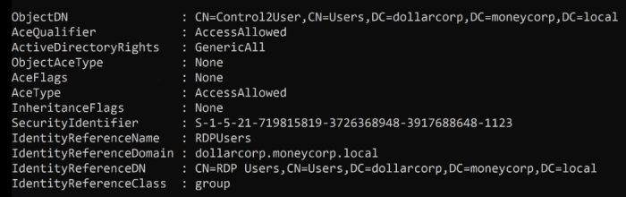

# AD Enumeration

Inventaire du domaine, des objets, des stratégies de groupe et des relations d'approbation. Les exemples supposent un environnement AD de laboratoire ou administré avec autorisation.

## Modules PowerShell

Les notes distinguent le module ActiveDirectory, PowerView, SharpView et BloodHound. Le module ActiveDirectory est fourni par Microsoft ; PowerView constitue une alternative pour interroger les objets du domaine.

### Charger le module ActiveDirectory

```powershell
Import-Module C:\AD\Tools\ADModule-master\Microsoft.ActiveDirectory.Management.dll
Import-Module C:\AD\Tools\ADModule-master\ActiveDirectory\ActiveDirectory.psd1
```

Charge les composants du module depuis les chemins du laboratoire. Adapter les chemins à l'installation.

### Charger PowerView

```powershell
. C:\AD\Tools\PowerView.ps1
```

Charge les fonctions du script dans la session PowerShell. Utiliser une copie de confiance dans le laboratoire.

### Domaine actuel

```powershell
Get-ADDomain
```

Affiche les propriétés du domaine courant.

### Domaine avec PowerView

```powershell
Get-Domain
```

Affiche les propriétés du domaine courant avec PowerView.

### Domaine désigné

```powershell
Get-ADDomain -Identity domain.local
```

Consulte les propriétés du domaine indiqué, accessible depuis la session.

### Domaine distant avec PowerView

```powershell
Get-Domain -Domain domain.local
```

Consulte les propriétés du domaine désigné.

### SID du domaine

```powershell
(Get-ADDomain).DomainSID
```

Affiche l'identifiant de sécurité du domaine.

### SID avec PowerView

```powershell
Get-DomainSID
```

Affiche le SID du domaine courant.

### Politique du domaine

```powershell
Get-DomainPolicyData
(Get-DomainPolicyData).systemaccess
```

Consulte les données de stratégie de domaine et leurs paramètres System Access.

### Politique d'un autre domaine

```powershell
(Get-DomainPolicyData -Domain domain.local).systemaccess
```

Affiche les paramètres System Access du domaine désigné.

### Contrôleurs de domaine

```powershell
Get-ADDomainController
```

Identifie un contrôleur de domaine.

### Contrôleurs avec PowerView

```powershell
Get-DomainController
```

Affiche les contrôleurs du domaine avec PowerView.

### Contrôleur d'un domaine désigné

```powershell
Get-ADDomainController -DomainName domain.local -Discover
```

Recherche un contrôleur disponible pour le domaine indiqué.

### Contrôleurs d'un autre domaine avec PowerView

```powershell
Get-DomainController -Domain domain.local
```

Consulte les contrôleurs du domaine indiqué.

## Utilisateurs et ordinateurs

### Utilisateurs

```powershell
Get-ADUser -Filter *
```

Liste les utilisateurs AD.

### Utilisateur désigné

```powershell
Get-ADUser -Identity student1 -Properties *
```

Affiche les propriétés accessibles du compte de laboratoire student1.

### Noms des propriétés utilisateur

```powershell
Get-ADUser -Filter * -Properties * | Select-Object -First 1 | Get-Member -MemberType *Property | Select-Object Name
```

Présente les propriétés exposées par les objets utilisateur du module.

### Utilisateurs avec PowerView

```powershell
Get-DomainUser
```

Affiche les objets utilisateur du domaine.

### Attribut pwdlastset

```powershell
Get-DomainUser -Properties pwdlastset
```

Affiche l'attribut relatif à la dernière modification du mot de passe.

### Propriétés de tous les utilisateurs

```powershell
Get-ADUser -Filter * -Properties *
```

Affiche les propriétés accessibles de chaque utilisateur.

### Utilisateur précis avec PowerView

```powershell
Get-DomainUser -Identity student1 -Properties *
```

Consulte les propriétés du compte de laboratoire.

### Nom de compte et nombre de connexions

```powershell
Get-DomainUser -Properties samaccountname,logonCount
```

Affiche les noms de compte et l'attribut logonCount.

### Date de modification du mot de passe

```powershell
Get-ADUser -Filter * -Properties pwdlastset,logoncount | Select-Object Name,logoncount,@{Name='PasswordLastSet';Expression={[datetime]::FromFileTime($_.pwdlastset)}}
```

Convertit l'attribut pwdLastSet au format date Windows. Une valeur nulle ou égale à zéro nécessite une interprétation particulière.

### Recherche dans les descriptions

```powershell
Get-ADUser -Filter 'Description -like "*built*"' -Properties Description | Select-Object Name,Description
```

Filtre les objets utilisateur dont la description contient le texte indiqué.

### Recherche LDAP dans les descriptions

```powershell
Get-DomainUser -LDAPFilter "Description=*built*" | Select-Object Name,Description
```

Filtre les descriptions des objets utilisateurs à partir d'une expression LDAP.

### Ordinateurs

```powershell
Get-ADComputer -Filter * | Select-Object Name
```

Liste les objets ordinateurs.

### Propriétés des ordinateurs

```powershell
Get-ADComputer -Filter * -Properties *
```

Consulte les propriétés accessibles des objets ordinateurs.

### Ordinateurs Windows Server 2022

```powershell
Get-ADComputer -Filter 'OperatingSystem -like "*Server 2022*"' -Properties OperatingSystem | Select-Object Name,OperatingSystem
```

Filtre les objets ordinateurs selon le système d'exploitation déclaré.

### Inventaire avec PowerView

```powershell
Get-DomainComputer | Select-Object Name,logonCount
```

Affiche les noms et compteurs d'ouvertures de session disponibles.

### Système d'exploitation avec PowerView

```powershell
Get-DomainComputer -OperatingSystem "*Server 2022*"
```

Filtre les ordinateurs selon la valeur déclarée dans Active Directory.

### Groupes

```powershell
Get-ADGroup -Filter * | Select-Object Name
```

Affiche les groupes du domaine.

### Propriétés des groupes

```powershell
Get-ADGroup -Filter * -Properties *
```

Consulte les propriétés accessibles des groupes AD.

### Groupes avec PowerView

```powershell
Get-DomainGroup | Select-Object Name
```

Affiche les noms des groupes du domaine.

### Groupes d'un autre domaine

```powershell
Get-DomainGroup -Domain domain.local
```

Inventorie les groupes du domaine indiqué.

### Recherche de groupes par nom

```powershell
Get-ADGroup -Filter 'Name -like "*admin*"' | Select-Object Name
```

Filtre les groupes dont le nom contient admin.

### Recherche de groupes avec PowerView

```powershell
Get-DomainGroup *admin*
```

Filtre les groupes dont le nom contient admin.

### Appartenances d'un utilisateur

```powershell
Get-ADPrincipalGroupMembership -Identity student1
```

Affiche les groupes associés au compte de laboratoire student1.

### Appartenances avec PowerView

```powershell
Get-DomainGroup -UserName "student1"
```

Affiche les groupes associés au compte de laboratoire.

### Membres du groupe Domain Admins

```powershell
Get-ADGroupMember -Identity "Domain Admins" -Recursive
```

Vérifie les appartenances directes et imbriquées du groupe sur un domaine anglophone.

### Groupes locaux d'une machine

```powershell
Get-NetLocalGroup -ComputerName domain-dc
```

Consulte les groupes locaux exposés par la machine désignée. Des permissions administratives peuvent être nécessaires.

### Membres d'un groupe avec PowerView

```powershell
Get-DomainGroupMember -Identity "Domain Admins" -Recurse
```

Consulte les membres directs et imbriqués du groupe désigné.

### Membres du groupe Administrators

```powershell
Get-NetLocalGroupMember -ComputerName domain-dc -GroupName Administrators
```

Vérifie la composition du groupe sur le système de laboratoire désigné. Les permissions nécessaires et le nom du groupe varient selon la machine.

## GPO et OU

### Unités organisationnelles

```powershell
Get-ADOrganizationalUnit -Filter * -Properties *
```

Inventorie les OU et leurs propriétés.

Les notes abordent les GPO liées aux ordinateurs et aux OU, ainsi que les appartenances aux groupes locaux définies par les stratégies.

### Stratégies de groupe

```powershell
Get-DomainGPO
```

Inventorie les GPO avec PowerView.

### GPO associées à un ordinateur

```powershell
Get-DomainGPO -ComputerIdentity domain-computer
```

Consulte les GPO applicables à l'ordinateur désigné.

### Unités organisationnelles avec PowerView

```powershell
Get-DomainOU
```

Liste les unités organisationnelles du domaine.

### GPO par identifiant

```powershell
Get-DomainGPO -Identity "{0D1CC23D-1F20-4EEE-AF64-D99597AE2A6E}"
```

Consulte une GPO identifiée par son GUID. Remplacer le GUID par celui de la stratégie auditée.

### Groupes locaux définis par GPO

```powershell
Get-DomainGPOLocalGroup
```

Consulte les paramètres de groupes locaux gérés par les stratégies.

### OU avec Get-NetOU

```powershell
Get-NetOU
```

Inventorie les unités organisationnelles avec l'alias PowerView, selon la version utilisée.

### Groupes locaux associés aux GPO

```powershell
Get-DomainGPOComputerLocalGroupMapping -ComputerIdentity domain-computer
```

Consulte les associations de groupes locaux définies par GPO pour l'ordinateur indiqué.

### Ordinateurs d'une OU

```powershell
(Get-DomainOU -Identity StudentMachines).distinguishedname | ForEach-Object { Get-DomainComputer -SearchBase $_ } | Select-Object Name
```

Liste les ordinateurs situés dans l'OU de laboratoire StudentMachines.

## ACL




Les ACL définissent les droits d'accès aux objets. Les droits GenericAll, GenericWrite, WriteDacl et WriteOwner méritent une revue dans le cadre d'un audit de délégation.

### ACL d'un objet de laboratoire

```powershell
Get-DomainObjectAcl -SamAccountName student1 -ResolveGUIDs
```

Consulte les entrées de contrôle d'accès de l'objet désigné et résout les GUID.

### ACL avec le fournisseur ActiveDirectory

```powershell
(Get-Acl 'AD:\CN=Administrator,CN=Users,DC=dollarcorp,DC=moneycorp,DC=local').Access
```

Affiche les ACE de l'objet désigné. Nécessite le lecteur AD: et un DN adapté au laboratoire.

### ACL du partage SYSVOL

```powershell
Get-PathAcl -Path "\\dcorp-dc.dollarcorp.moneycorp.local\sysvol"
```

Consulte les permissions du chemin SYSVOL désigné. Adapter le nom du contrôleur au laboratoire.

## Trusts et forêts

### Forêt courante

```powershell
Get-ADForest
```

Affiche les propriétés de la forêt.

### Relations d'approbation

```powershell
Get-ADTrust -Filter *
```

Inventorie les relations d'approbation visibles.

### Catalogues globaux

```powershell
Get-ADForest | Select-Object -ExpandProperty GlobalCatalogs
```

Liste les catalogues globaux.

### Forêt désignée

```powershell
Get-ADForest -Identity domain.local
```

Consulte les propriétés de la forêt indiquée.

### Domaines de la forêt

```powershell
(Get-ADForest).Domains
```

Liste les domaines appartenant à la forêt courante.

### Forêt avec PowerView

```powershell
Get-Forest
```

Affiche les propriétés de la forêt avec PowerView.

### Domaines avec PowerView

```powershell
Get-ForestDomain
```

Liste les domaines de la forêt courante.

### Catalogues globaux avec PowerView

```powershell
Get-ForestGlobalCatalog
```

Liste les catalogues globaux de la forêt.

### Relation d'approbation désignée

```powershell
Get-ADTrust -Identity domain.local
```

Consulte les propriétés de la relation d'approbation indiquée.

### Trusts avec PowerView

```powershell
Get-DomainTrust
```

Inventorie les relations d'approbation du domaine courant.

### Trusts d'un domaine désigné

```powershell
Get-DomainTrust -Domain domain.local
```

Consulte les relations d'approbation du domaine indiqué.

### Forêt désignée avec PowerView

```powershell
Get-Forest -Forest domain.local
```

Affiche les propriétés de la forêt indiquée.

### Domaines d'une forêt désignée

```powershell
Get-ForestDomain -Forest domain.local
```

Liste les domaines de la forêt spécifiée.

### Catalogues globaux d'une forêt désignée

```powershell
Get-ForestGlobalCatalog -Forest domain.local
```

Liste les catalogues globaux de la forêt spécifiée.

### Approbations de forêt

```powershell
Get-ForestTrust -Forest domain.local
```

Consulte les relations d'approbation de la forêt désignée.

### Trusts de la forêt courante

```powershell
Get-ForestTrust
```

Consulte les relations d'approbation de la forêt courante avec PowerView.

## User Hunting et BloodHound

Le chapitre source traite des sessions utilisateurs, des partages, des relations de groupes et des chemins d'administration. BloodHound représente les relations sous forme de graphe ; les données collectées doivent rester limitées au périmètre autorisé.

## Ressources

- [ADModule](https://github.com/samratashok/ADModule)
- [BloodHound](https://github.com/BloodHoundAD/BloodHound)
- [SharpView](https://github.com/tevora-threat/SharpView/)
