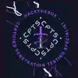
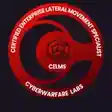
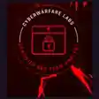
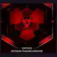

  
SKILL-ISSUE · LIHAM

  <h1>Morad H.</h1>
  
Adversary Simulation · Penetration Testing · Cyberdéfense

  
Audits de sécurité, simulation d’adversaire et recherche de vulnérabilités. Un parcours entre service public, défense et recherche indépendante.

  

    <a href="/skill-issue/oscp/">Notes OSCP</a>
    <a href="/skill-issue/crto/">Notes CRTO</a>
    <a href="https://www.linkedin.com/in/l14m" target="_blank" rel="noopener noreferrer">LinkedIn</a>
  

## Parcours

  

  <a class="profile-marquee-item" href="https://www.economie.gouv.fr/" target="_blank" rel="noopener noreferrer" title="Ministère de l’Économie">
    
    Ministère de l’Économie
  </a>
  <a class="profile-marquee-item" href="https://www.interieur.gouv.fr/" target="_blank" rel="noopener noreferrer" title="Ministère de l’Intérieur">
    
    Ministère de l’Intérieur
  </a>
  <a class="profile-marquee-item" href="https://www.police-nationale.interieur.gouv.fr/" target="_blank" rel="noopener noreferrer" title="Police nationale">
    
    Police nationale
  </a>
  <a class="profile-marquee-item" href="https://www.defense.gouv.fr/terre" target="_blank" rel="noopener noreferrer" title="Armée de Terre">
    
    Armée de Terre
  </a>
  <a class="profile-marquee-item" href="https://www.sengager.fr/tous-nos-regiments/regiment-de-cyberdefense" target="_blank" rel="noopener noreferrer" title="Régiment de cyberdéfense">
    
    Régiment de cyberdéfense
  </a>
  <a class="profile-marquee-item" href="https://www.defense.gouv.fr/comcyber" target="_blank" rel="noopener noreferrer" title="COMCYBER">
    
    COMCYBER
  </a>
  <a class="profile-marquee-item" href="https://www.nasa.gov/" target="_blank" rel="noopener noreferrer" title="NASA">
    
    NASA
  </a>
  <a class="profile-marquee-item" href="https://www.nato.int/" target="_blank" rel="noopener noreferrer" title="OTAN">
    
    OTAN
  </a>
  <a class="profile-marquee-item" href="https://ccdcoe.org/exercises/locked-shields/" target="_blank" rel="noopener noreferrer" title="Locked Shields 2025">
    
    Locked Shields
  </a>

  <a class="profile-marquee-item" href="https://www.police-nationale.interieur.gouv.fr/nous-decouvrir/notre-organisation/organisation/direction-nationale-de-police-judiciaire-dnpj" target="_blank" rel="noopener noreferrer" title="DNPJ">
    DNPJ
    Police judiciaire · DNPJ
  </a>
  <a class="profile-marquee-item" href="https://www.police-nationale.interieur.gouv.fr/actualite/lofmin-office-expert-pour-lutter-contre-violences-faites-aux-mineurs" target="_blank" rel="noopener noreferrer" title="OFMIN">
    
    Office mineurs · OFMIN
  </a>
  <a class="profile-marquee-item" href="https://www.2600.eu/" target="_blank" rel="noopener noreferrer" title="École 2600">
    
    École 2600
  </a>

  <a class="profile-marquee-item" href="https://www.economie.gouv.fr/" target="_blank" rel="noopener noreferrer" tabindex="-1" title="Ministère de l’Économie">
    
    Ministère de l’Économie
  </a>
  <a class="profile-marquee-item" href="https://www.interieur.gouv.fr/" target="_blank" rel="noopener noreferrer" tabindex="-1" title="Ministère de l’Intérieur">
    
    Ministère de l’Intérieur
  </a>
  <a class="profile-marquee-item" href="https://www.police-nationale.interieur.gouv.fr/" target="_blank" rel="noopener noreferrer" tabindex="-1" title="Police nationale">
    
    Police nationale
  </a>
  <a class="profile-marquee-item" href="https://www.defense.gouv.fr/terre" target="_blank" rel="noopener noreferrer" tabindex="-1" title="Armée de Terre">
    
    Armée de Terre
  </a>
  <a class="profile-marquee-item" href="https://www.sengager.fr/tous-nos-regiments/regiment-de-cyberdefense" target="_blank" rel="noopener noreferrer" tabindex="-1" title="Régiment de cyberdéfense">
    
    Régiment de cyberdéfense
  </a>
  <a class="profile-marquee-item" href="https://www.defense.gouv.fr/comcyber" target="_blank" rel="noopener noreferrer" tabindex="-1" title="COMCYBER">
    
    COMCYBER
  </a>
  <a class="profile-marquee-item" href="https://www.nasa.gov/" target="_blank" rel="noopener noreferrer" tabindex="-1" title="NASA">
    
    NASA
  </a>
  <a class="profile-marquee-item" href="https://www.nato.int/" target="_blank" rel="noopener noreferrer" tabindex="-1" title="OTAN">
    
    OTAN
  </a>
  <a class="profile-marquee-item" href="https://ccdcoe.org/exercises/locked-shields/" target="_blank" rel="noopener noreferrer" tabindex="-1" title="Locked Shields 2025">
    
    Locked Shields
  </a>

  <a class="profile-marquee-item" href="https://www.police-nationale.interieur.gouv.fr/nous-decouvrir/notre-organisation/organisation/direction-nationale-de-police-judiciaire-dnpj" target="_blank" rel="noopener noreferrer" tabindex="-1" title="DNPJ">
    DNPJ
    Police judiciaire · DNPJ
  </a>
  <a class="profile-marquee-item" href="https://www.police-nationale.interieur.gouv.fr/actualite/lofmin-office-expert-pour-lutter-contre-violences-faites-aux-mineurs" target="_blank" rel="noopener noreferrer" tabindex="-1" title="OFMIN">
    
    Office mineurs · OFMIN
  </a>
  <a class="profile-marquee-item" href="https://www.2600.eu/" target="_blank" rel="noopener noreferrer" tabindex="-1" title="École 2600">
    
    École 2600
  </a>

  

## Distinctions

  <a href="https://drive.google.com/file/d/1RV5HkejIYTPiAiXKnAGwoR8wszsXBunR/view" target="_blank" rel="noopener noreferrer">
    <strong>NASA</strong>
    Lettre de reconnaissance.
  </a>
  <a href="https://drive.google.com/file/d/1jQdPvtwOGkg3NKXgAksmnc1OO_N4V8Ri/view" target="_blank" rel="noopener noreferrer">
    <strong>Locked Shields · OTAN</strong>
    Sélectionné pour représenter la France · 2ᵉ/17.
  </a>
  

    <strong>Régiment de cyberdéfense</strong>
    Sergent-chef de réserve · Armée de Terre.
  

  

    <strong>Première dame de France</strong>
    Rencontre avec Mme Brigitte Macron.
  

  

    <strong>Ministère des Armées · DefHack</strong>
    Équipe lauréate · COMCYBER.
  

  <a href="https://www.2600.eu/wp-content/uploads/2025/02/Capital-30-01-2025-Pages-15455.pdf" target="_blank" rel="noopener noreferrer">
    <strong>Capital</strong>
    « À l’école des hackers éthiques ».
  </a>

## Certifications

<a class="profile-credential" href="https://credentials.offsec.com/bcdddac4-a517-4bee-a403-25186e3ef64d#acc.vMybJWGj" target="_blank" rel="noopener noreferrer" title="Consulter le justificatif OSCP+">OSCP+OSCP+OffSecVérifier la certification ↗</a>
<a class="profile-credential" href="https://credentials.offsec.com/755cac44-117f-407d-8d71-a8fda4aed16e#acc.DNIqrLYR" target="_blank" rel="noopener noreferrer" title="Consulter le justificatif OSCP">OSCPOSCPOffSecVérifier la certification ↗</a>
<a class="profile-credential" href="https://www.credly.com/badges/b8c441d3-32fe-4c4c-a5d9-a4bf3603518a" target="_blank" rel="noopener noreferrer" title="Consulter le justificatif CPTS">CPTSCPTSHack The BoxVérifier la certification ↗</a>
<a class="profile-credential" href="https://www.credly.com/badges/288e1eda-2869-49de-bce7-df94921952be" target="_blank" rel="noopener noreferrer" title="Consulter le justificatif CWES">CWESCWESHack The BoxVérifier la certification ↗</a>
<a class="profile-credential" href="https://certs.zeropointsecurity.co.uk/97e8bb4c-2937-4c21-bf35-ad5cc17f6cb0#acc.eHDIiFMZ" target="_blank" rel="noopener noreferrer" title="Consulter le justificatif CRTO">CRTOCRTOZero-Point SecurityVérifier la certification ↗</a>
<a class="profile-credential" href="https://www.credential.net/d12bd51b-a46f-465b-a0a0-864836ebbabe#acc.YSC4fPQl" target="_blank" rel="noopener noreferrer" title="Consulter le justificatif eCPPT">eCPPTeCPPTINEVérifier la certification ↗</a>
<a class="profile-credential" href="https://certs.ine.com/760a7a7b-45c6-4c7c-9f9d-b2cc242bff98#acc.68u4fLsA" target="_blank" rel="noopener noreferrer" title="Consulter le justificatif eWPT">eWPTeWPTINEVérifier la certification ↗</a>
<a class="profile-credential" href="https://certs.ine.com/64620d1c-4fa1-42a4-b5db-b5bed9d8043f#acc.xdi6rWLK" target="_blank" rel="noopener noreferrer" title="Consulter le justificatif eCDFP">eCDFPeCDFPINEVérifier la certification ↗</a>
<a class="profile-credential" href="https://www.credential.net/9fa9a030-586f-4619-8239-da3707ac43f0#acc.ywcSZvLV" target="_blank" rel="noopener noreferrer" title="Consulter le justificatif CELMS">CELMSCELMSCyberWarFare LabsVérifier la certification ↗</a>
<a class="profile-credential" href="https://labs.cyberwarfare.live/credential/achievement/68c56fc9806f169445f5b8ab" target="_blank" rel="noopener noreferrer" title="Consulter le justificatif CRTA">CRTACRTACyberWarFare LabsVérifier la certification ↗</a>
<a class="profile-credential" href="https://labs.cyberwarfare.live/credential/achievement/68f53d1242b3b10b486f5c93" target="_blank" rel="noopener noreferrer" title="Consulter le justificatif CRT-ID">CRT-IDCRT-IDCyberWarFare LabsVérifier la certification ↗</a>
<a class="profile-credential" href="https://labs.hackthebox.com/achievement/badge/1543889/80" target="_blank" rel="noopener noreferrer" title="Consulter le justificatif APTLabs">APTLabsAPTLabsHack The Box · Pro LabVérifier la certification ↗</a>
<a class="profile-credential" href="https://drive.google.com/file/d/1MfyKGqUnnigKTa1kYU8Kxp29k0YGhaUI/view" target="_blank" rel="noopener noreferrer" title="Consulter le justificatif CCDCOE">CCDCOECCDCOEOTAN · FormationVérifier la certification ↗</a>
<a class="profile-credential" href="https://labs.cyberwarfare.live/credential/achievement/69fdacf31b56196d1f214b5d" target="_blank" rel="noopener noreferrer" title="Vérifier la certification COPO">COPOCOPOCyberWarFare LabsVérifier la certification ↗</a>

